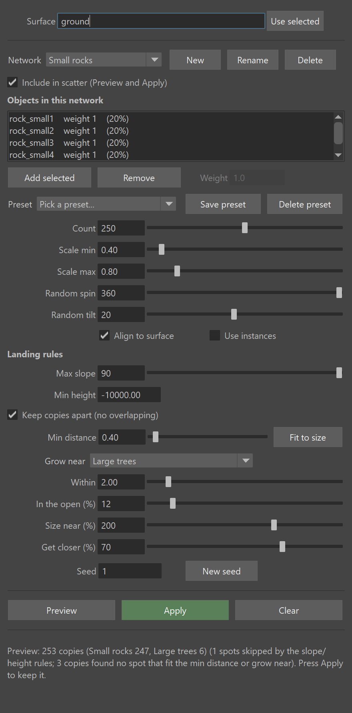

# Scatter Tool for Maya

A Maya window that takes one or more objects (rocks, trees, props) and
scatters many copies of them across a surface you pick, with random size, spin
and tilt, so you can fill a scene in seconds instead of placing props by hand.
Group objects into **networks** that share settings, e.g. five small rocks
in one network and three kinds of large trees in another, and scatter them
all at once. Give each object a weight to say how often it shows up, keep
copies from overlapping, and let one network grow near another, like bushes
crowding around trees.



## Which app

- **App:** Autodesk Maya 
- No extra installs. It only uses Maya's own Python 

## How to run it

1. Get the code from the repo.

2. Open Maya.

3. Open the Script Editor (**Windows > General Editors > Script Editor**) and
   click the **Python** tab at the bottom.

4. Paste these lines. Change the `folder` line to wherever your `MIDTERM`
   folder is (use forward slashes):

   ```python
   import maya.cmds as cmds
   folder = "C:/Users/you/sva-python-scripts/MIDTERM"
   cmds.file(folder + "/scatter_test_scene.ma", open=True, force=True)
   exec(open(folder + "/scatter_tool.py").read())
   ```

   The third line opens the test scene, with a hilly `ground` and a small
   `rock` off to the left. `force=True` throws away unsaved changes in the
   scene you had open, so save first if you need to. Leave that line out to
   use your own scene instead. The last line runs the tool. There's no
   separate import step.

5. Run it: press **Ctrl+Enter**, or click the **Execute All** button (the
   double play arrow) at the top of the Script Editor. The **Scatter Tool**
   window opens.

Don't press Ctrl+S in the test scene, or you'll overwrite the repo's copy.

## How to use it

1. Click the `ground`, then click **Use selected** next to **Surface**.
2. Click the `rock` in the viewport, then click **Add selected** under
   **Objects in this network**. You can select several objects and add them
   at once.
3. Click **Preview**. Copies appear on the ground in a group called
   `scatter_preview`.
4. Move any slider or change any box. When you let go, the preview redraws.
5. Click **New seed** for a different layout with the same settings. The same
   seed number always gives the same layout.
6. Click **Apply** to keep it. The copies go into one group (`scatter_grp1`,
   `scatter_grp2`, ...). One **Ctrl+Z** removes the whole scatter.
7. **Clear** removes the preview. If there's no preview, it removes the last
   scatter you applied.

The line at the bottom of the window says what happened or what's wrong.

### Networks

A network is a set of objects that share the same settings. Say you want lots
of small rocks and a few big trees: put five rocks in a "Small rocks" network
(count 120, scale 0.4 to 1.0) and three trees in a "Large trees" network
(count 20, scale 1.5 to 2.5, max slope 25, Align to surface off so they grow
straight up).

- The window starts with one network, "Network 1". **Rename** gives it a
  better name.
- **New** makes another network. It starts empty, with its own seed, so it
  doesn't land on the same spots as the others.
- The **Network** menu picks which network the window is showing. The object
  list and everything below it (presets, sliders, landing rules, seed) belong
  to that network.
- **Delete** removes the network showing in the menu. There's always at least
  one.
- **Include in scatter** switches a network on or off without deleting it.

The **Surface** is shared by every network. **Preview** and **Apply** scatter
every network that's switched on, all at once. Apply makes one group with a
group for each network inside it (`scatter_grp1|Small_rocks`,
`scatter_grp1|Large_trees`), and one Ctrl+Z still removes everything.
Changing one network's settings doesn't move the copies of any other network,
unless Keep copies apart is on (see below).

### Keeping copies apart

By default copies can overlap. To stop that, tick **Keep copies apart** under
the landing rules. Each network has its own setting.

- **Min distance** is how far apart this network's copies stay, measured
  center to center along the ground.
- **Fit to size** sets Min distance to the width of the widest object in the
  network at Scale max, so even the biggest copies don't touch.
- A network with Keep copies apart on also stays clear of other networks'
  copies. The gap is half of each network's Min distance added together. With
  trees at 3 and rocks at 0.6, rocks stay 1.8 from a tree's center.
- Untick it on one network to let that network overlap freely, e.g. let
  rocks sit under trees, while the trees still keep apart from each other.
- Networks with a bigger Min distance are placed first, so trees get their
  space before the rocks fill in around them.

When a spot is too close, the tool tries up to 30 other spots. If none of them
fit, that copy is left out, and the status line says how many didn't fit.
Lower the Count or the Min distance if that happens a lot.

### Grow near

In nature some things crowd together: bushes grow thicker around trees than
out on open grass. **Grow near** does that. Pick another network in the menu
(say "Large trees" while showing "Bushes"), and this network's copies gather
around that network's copies.

- **Within** is how far from a tree still counts as near. If the trees keep
  copies apart, it's measured from the edge of the space they keep clear,
  not from the trunk.
- **In the open (%)** is how many copies still grow away from the trees.
  0 means none; 100 means Grow near has no effect.
- The pull fades smoothly from the tree out to Within, so there's no hard
  ring around each tree.
- **Size near (%)** changes the size of copies close to the trees. 100 means
  no change, 200 makes copies right by a tree twice as big, and 50 makes them
  half as big. It fades back to normal size at Within, so copies out in the
  open keep their normal size. Scale min and max still apply on top.
- Tick Keep copies apart on the bushes too, and they hug the trees without
  landing inside the trunks. Copies made bigger by Size near keep more space
  clear too, so they don't overlap.
- **Get closer (%)** lets copies into the space the trees keep clear. With
  the trees at Min distance 3, each tree keeps 1.5 clear around its trunk,
  which normally holds bushes out at the edge of the canopy. 0 keeps them
  outside that space, and 100 lets them right up to the trunk, keeping only
  their own Min distance. The trees still keep apart from each other.

The network you grow near is always placed first. A network can grow near one
other network, and two networks can't grow near each other. If the network
you grow near is switched off, this one spreads everywhere instead. Renaming
or deleting a network updates the networks that grow near it.

A copy that keeps landing out in the open tries up to 30 other spots, like
with Keep copies apart, and the status line says if any found no spot.

### Several objects with weights

Add more than one object to mix them. Each one starts with a weight of 1. To
change it, click its row in the list and type a new **Weight**. The list shows
each object's share, e.g. `rock  weight 3  (75%)` and `bush  weight 1  (25%)`
means about three rocks for every bush. A weight of 0 leaves an object out
without removing it. **Remove** takes the clicked row out of the list.

Changing weights only swaps which object sits on each spot. The spots
themselves stay where they were.

### Presets

The **Preset** menu loads saved slider settings into the network that's
showing. It starts with two: "Sparse rocks" and "Dense grass".

- **Save preset** asks for a name and saves the sliders, checkboxes and seed
  under it. Use an existing name to replace that preset.
- **Delete preset** removes the one showing in the menu.

Presets don't save the objects or the surface, since those change from scene
to scene.

### Remembered settings

The window saves your settings every time you change something. Next time you
open it, even after restarting Maya, all your networks and their settings come
back. The objects and surface come back too, if they're in the scene you have
open.

Presets and remembered settings are saved in `scatter_tool.json` in your Maya
user folder (on Windows, `Documents/maya/scatter_tool.json`). Delete that file
to start fresh.

### The controls

| Control | What it does |
| --- | --- |
| Surface | The mesh the copies land on, shared by every network |
| Network | Pick, make, rename or delete a network |
| Include in scatter | Whether this network is part of Preview and Apply |
| Objects in this network | The objects to copy, each with a weight for how often it shows up |
| Preset | Load, save or delete saved settings for this network |
| Count | How many copies (1 to 500) |
| Scale min / Scale max | Each copy gets a random size between these |
| Random spin | Random turn around the copy's up direction, 0 to 360 degrees |
| Random tilt | Random lean, 0 to 45 degrees, so copies don't all stand perfectly straight |
| Align to surface | On: copies lean with the slope of the ground. Off: copies stand straight up |
| Use instances | Copies share one mesh, which keeps heavy scenes light (only used by Apply; the preview always uses instances) |
| Max slope | Nothing lands on ground steeper than this angle. 90 means no limit |
| Min height | Nothing lands below this height, e.g. to keep a water's edge clear |
| Keep copies apart | On: copies don't land closer than Min distance. Off: copies can overlap |
| Min distance | How far apart this network's copies stay, center to center, along the ground |
| Fit to size | Sets Min distance to the widest object at Scale max, so copies don't touch |
| Grow near | Anywhere, or another network for this one to gather around |
| Within | How far from the other network's copies counts as near |
| In the open (%) | How many copies still grow away from the other network |
| Size near (%) | How big copies are right by the other network, fading to normal size at Within |
| Get closer (%) | How far copies may go into the space the other network keeps clear |
| Seed | Picks the layout. Same seed + same settings = same layout |

### Using your own objects

- The surface must be a polygon mesh.
- Delete the original objects afterwards, or move them away, if you don't want
  them in the scene.

## What works now

- The window, with every control from the pitch.
- Networks: sets of objects with their own settings, all scattered at once,
  each in its own group. Objects can be groups too (a tree made of a trunk
  and a top).
- Several objects with weights (from the pitch feedback). The status line
  says how many of each were made, e.g. `60 copies (rock 47, bush 13)`.
- Presets saved to a file, with two starters.
- The window remembers your last settings, even after restarting Maya.
- Copies land on the real surface, including hills, and lean with the slope.
  The lean blends between faces, so it stays smooth on low-poly ground.
- Random scale, spin and tilt, repeatable with the seed, and a New seed button.
- Preview, which redraws when you change a control, and isn't added to the
  undo list.
- Apply puts everything in one group, and one Ctrl+Z removes it.
- Clear.
- Use instances.
- Landing rules: max slope and min height (from the pitch feedback).
- Grow near: one network gathers around another, with a distance and a share
  that still grows in the open. With 7 trees, Within 2.5 and In the open 5%,
  90% of 198 bushes landed near a tree. Size near: at 250%, bushes next to
  trees came out 2.1 times the size of bushes in the open on average.
- Keep copies apart, with a min distance per network, a Fit to size button,
  and spacing between networks too (from the pitch feedback).
- Messages instead of errors when nothing is picked, an object can't be
  found, the surface isn't a mesh, the surface is also in the object list, or
  every weight is 0.

Checked in Maya 2026: copies sit within 0.06 units of a smooth hill and lean
within 3 degrees of its slope, and Apply, Ctrl+Z, Preview, New seed, Clear and
the error messages were each run in a real Maya session with the window open.
With weights rock 3 and bush 1, 400 copies came out as 287 rocks and 113
bushes. With one object, the layout is the same as before weights were added,
so old seeds still give the same result.

## What doesn't work yet

- **Min distance is measured from each copy's center**, not its real shape.
  Fit to size uses the widest object, so long thin objects (logs) get more
  room than they need in one direction.
- Preview at 500 copies on a very dense mesh takes a few seconds, so it only
  redraws when you let go of a slider, not while you drag.
- Copies land on whichever side of the mesh they're on. Skip a surface
  with overhangs or caves for now.

## Plan for the rest of the midterm

From the pitch, with the teacher's feedback:

- **By Oct 20:** copies on the real surface, tilt, scale, spin, seed, Preview
  and Clear. Done, plus the slope and height landing rules.
- **By Oct 26:** presets saved to a file, remembered settings, and scattering
  several objects with weights. Done.
- **Extra, added Oct 20:** networks, and minimum distance between copies (a
  stretch goal from the feedback). Done.
- **Extra, added Oct 20:** Grow near, so one network gathers around another,
  with Size near to make copies bigger or smaller close to it, and Get closer
  to let them in toward the trunks.
- **Stretch goal left:** a painted density mask.

## Peer run

_Classmate's name:_ Alfredo (ALF-Mii)

_Their three sentences (what they did, what happened, what confused them or
broke):_

1. "I cloned the repo, opened scatter_test_scene.ma in Maya 2027, imported
   and ran scatter_tool.py from the Script Editor, then set Object to rock and
   Surface to ground with 'Use selected', hit Preview, raised Count to 200,
   and hit New seed, Apply and Clear."
2. "Everything your README promises worked — the window opened, the preview
   drew 50 copies and redrew to 200 when I changed the count, the same seed
   reproduced the same layout and a different seed didn't, one Ctrl+Z removed
   all 200 copies in a single step, 'Use instances' shared one mesh across all
   of them, and the copies sat at most 0.0403 units off the hill and leaned
   0.000° off its slope, both inside the 0.06 / 3° numbers you claimed."
3. "Nothing broke, but the two install steps were my only stumbling block: the
   README asks me to 'paste python import command' and to 'open the test
   scene by pasting the script' without ever showing the actual commands, so I
   had to work out the sys.path.append + import scatter_tool lines and the
   cmds.file(..., open=True) call myself, and it isn't clear whether step 3 is
   still needed once step 5 has me paste the whole script anyway."

_What I'll fix:_ Write the actual commands into the "How to run it" steps (the
line that opens the test scene and the line that runs the tool), and drop the
separate import step, since pasting or opening the whole script already runs
it.

## Recording

(https://youtu.be/2UrF8U327YE)
