# Process images

Pictures from along the way, kept for the final presentation.

## 2026-11-05: lighting balance test

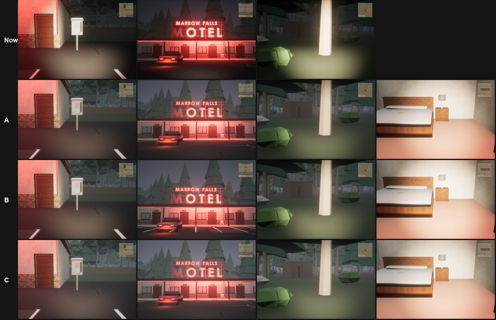

Four views (payphone, motel front, woods, Room 104), one row per lighting option:

- **Now**: the current lighting (exposure bias 7.3, flashlight 560). Bright flashlight pool, but whatever the beam hits head-on (tree trunk, payphone) goes nearly white.
- **A**: flashlight at about a third, everything else 2.5x brighter.
- **B**: flashlight at about half, everything else 2.5x brighter.
- **C**: like A, everything else 3.5x brighter, lamps a little dimmer.

A, B and C stopped the white burn-out, but the flashlight lost its pool of light on the ground.
**Decision: keep "Now".** The strong beam is part of the look.

Made with a test script that changed every light at once, played the game, jumped the player to each view and took a screenshot.

## 2026-11-05: Room 104 (Cas's room), "frozen in time"

Chosen direction: her things are where she left them a year ago, as if she meant to come back
that night, under a year of damp. Extras: her lake photos taped over the dresser and her camera by
the TV, a twig figure hanging over the bed, a red bulb in the bedside lamp (the red-light theme),
grime (ceiling water stain with a drip streak, peeling wallpaper, cobwebs, yellowed sheets).
Every shot: entering from the door · the photo wall over the dresser · the table by the window · the bed.

### Her photos

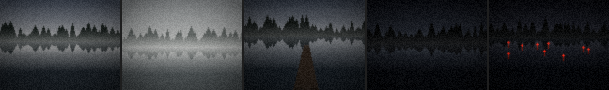

Drawn by `tools/make_photos.py` (128 x 96, like cheap disposable-camera prints): lake at dusk,
lake in fog, the dock, the lake at night, and the odd one out, red lights out on the water
(a hint at the lantern ritual).

### First pass

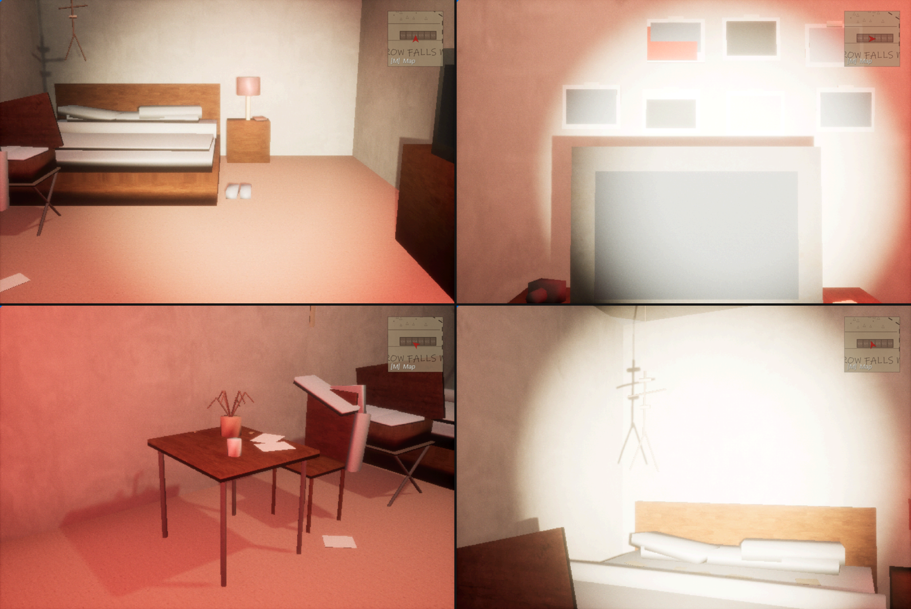

Layout works, but: the new colors came out near-white (the texture tint replaced the Maya color),
the blanket roll read as pipes, the red lamp light tinted the whole room pink, and the photos were
blank grey cards.

### Second pass

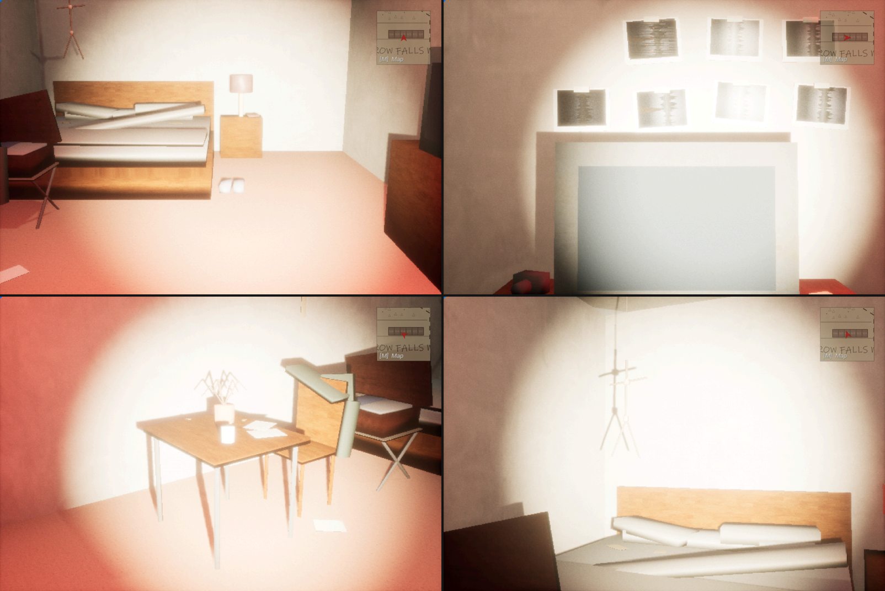

Photos now have pictures but were mapped sideways (stripes); the suitcase lid and jacket were tilted
on the wrong axis. The flashlight state differed from v1, which showed the real problem: inside a
small room the beam burns everything white (screen mean 200-220 of 255).

### Third pass: flashlight off vs on

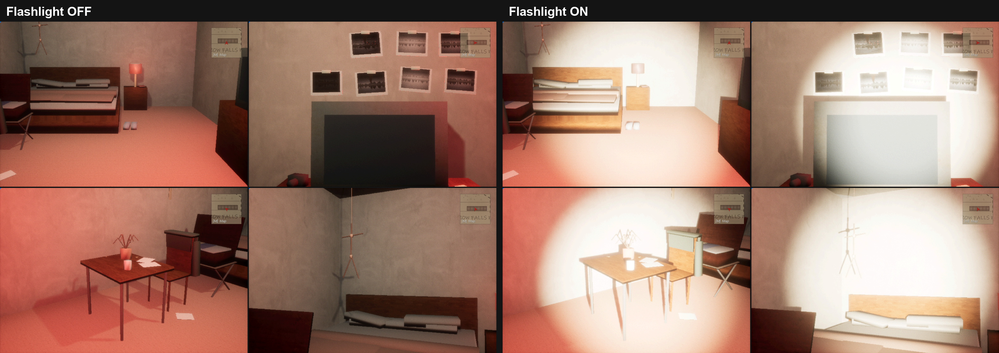

Photos upright, bedspread bunched at the foot, jacket over the chair, suitcase lid leaning back.
Left (flashlight off) shows the dressing itself (mean ~100); right (on) is still burnt out.
**Decision:** the flashlight auto-dims when what it points at is close (like your eyes adjusting),
and stays exactly the same outdoors.

### Flashlight indoors: how strong?

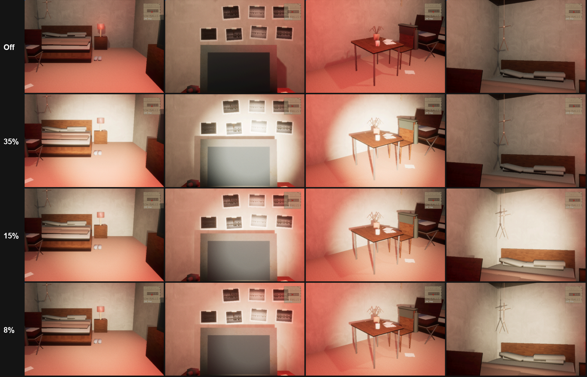

First try dimmed the beam by distance to what it hits, but the room is 5 m deep, so most walls
were "far" and nothing changed. Now the HUD also checks for a ceiling within 2.5 m above your
eyes: indoors, the beam drops to a set share of its power; outside nothing changes (woods and
motel front measured the same as before). Rows: flashlight off, 35%, 15%, 8% (the 35% bed shot
caught a flicker cut-out). **Picked: 15%**: a soft pool on the wall, photos and table readable.

### Red lamp, new carpet, red kept outside

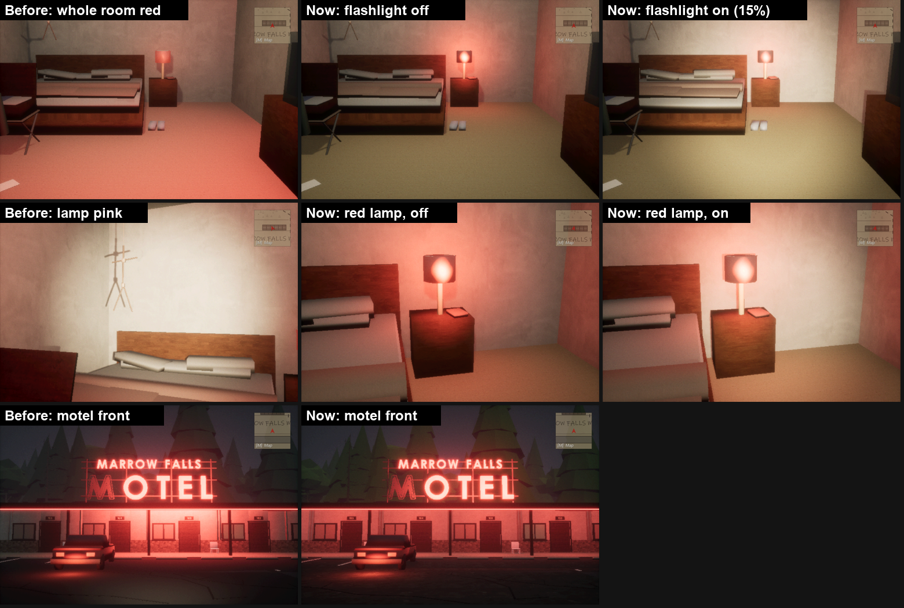

Your notes: "change the carpet color", "I don't want the whole room red, just the lamp", and the lamp
looked pink, not like a real light. Causes and fixes:
- **Whole room red:** the big outside lights (sign letters, cross, OPEN, lot lamps, streetlight) cast no
  shadows, so their light went straight through the walls. They now cast shadows, so walls block them.
  That also took the red glow off the motel's front wall (the awning blocked the sign), so six red
  wash lights under the awning (one per room, also shadowed) put it back. The front looks close to before.
- **Pink lamp:** the shade's glow was so strong it bloomed to pinky white. Turned down (3 to 0.6) so
  it reads as red, and the bulb is now a real point light with inverse-square falloff right at the
  lamp: hot at the bulb, fading across the wall and nightstand.
- **Carpet:** from red to a worn khaki brown (all rooms).

### The lamp, still pink → deep red

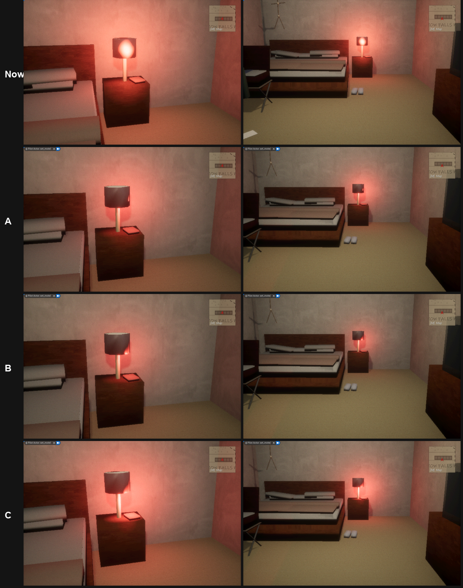

Your note: "the lamp color is still pink". Very bright red bleaches toward pink and white on screen,
and it was too bright in two places: the shade's glow, and the bulb light sitting inside the shade
(it burnt a white spot into it and turned the cream wall pink). Tried three dimmer, pure-red versions
(A, B, C, with the bulb moved under the shade). B was the reddest but its shade went dark grey.

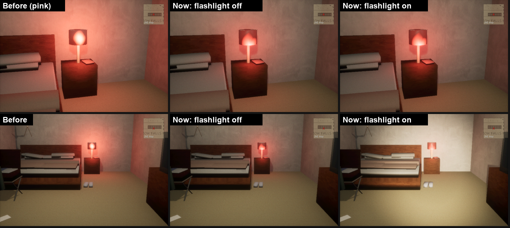

Final: bulb under the shade, pure red, dim (9); the shade is now red fabric itself (it showed grey in
the flashlight before) with a soft glow (0.5).

## 2026-11-05: "really bad artifacting everywhere"

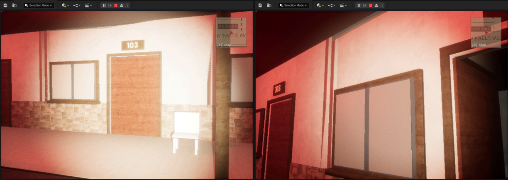

Two frames from recording your screen while you played: saw-tooth shadow edges along the awning and
posts, thin bright lines leaking along the window and door frames, and shadow bands that crawled as
you moved. Cause: the shadows turned on for the outside lights earlier today (to stop the sign's red
shining through the walls into the rooms). Point-light shadows at this resolution, with no
anti-aliasing, look like this. (A first guess, turning off motion blur and ambient occlusion, didn't
help and changed the look, so it was undone.)

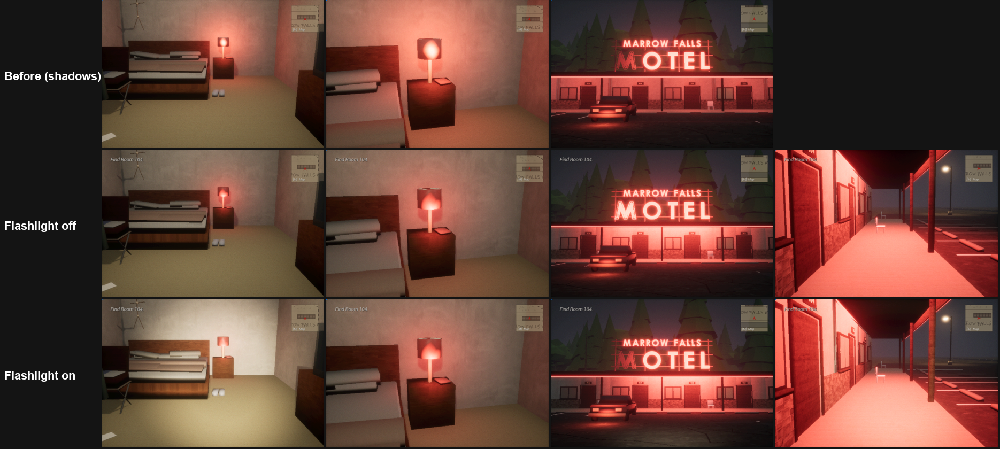

Fix without any shadows: **lighting channels**. The motel is now two meshes: the outside
(`set_motel`) and the room insides (`set_motel_rooms`, with a thin lining on the inside of the front
wall). The room insides and the room lamps are on channel 1; the sign, cross, lot and street lights
are on channel 0, so they can't reach inside. The flashlight and the moonlight light both. All lights
are back to no shadows, the six extra awning lights are gone, and the motel front looks like it did
originally (top row: the shadowed version; middle/bottom: now, flashlight off/on).

### The real culprit: the flashlight's own shadow

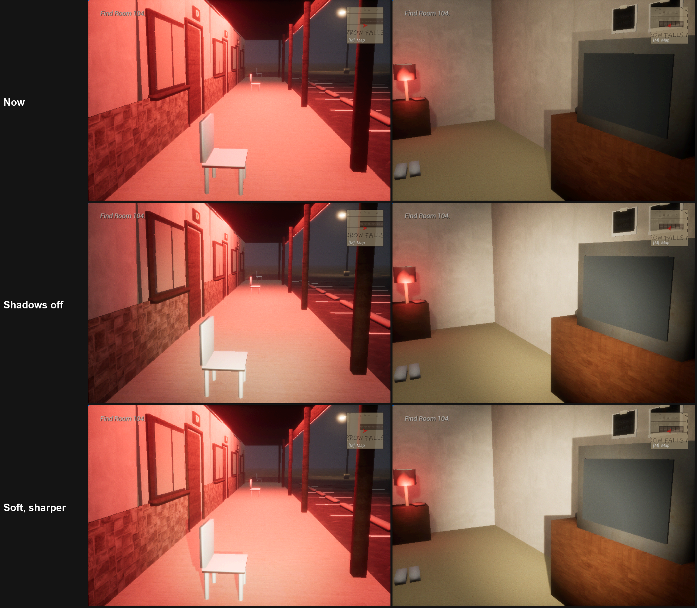

Your note: "it did not fix it at all" (worst on the walkway). The lighting-channel change was still
worth keeping, but the artifacts came from the one light that still cast shadows: the flashlight.
It's held off to the right and bobs with every step, so its hard, low-resolution shadow (the dark
band beside the TV and dresser, the patch by the chair, the post and frame edges on the walkway)
jittered and crawled all the time. Rows: now · shadows off · softer, sharper shadows (only blurs it).
**Fix: flashlight casts no shadows.**

### What you actually meant: textures flashing in and out (z-fighting)

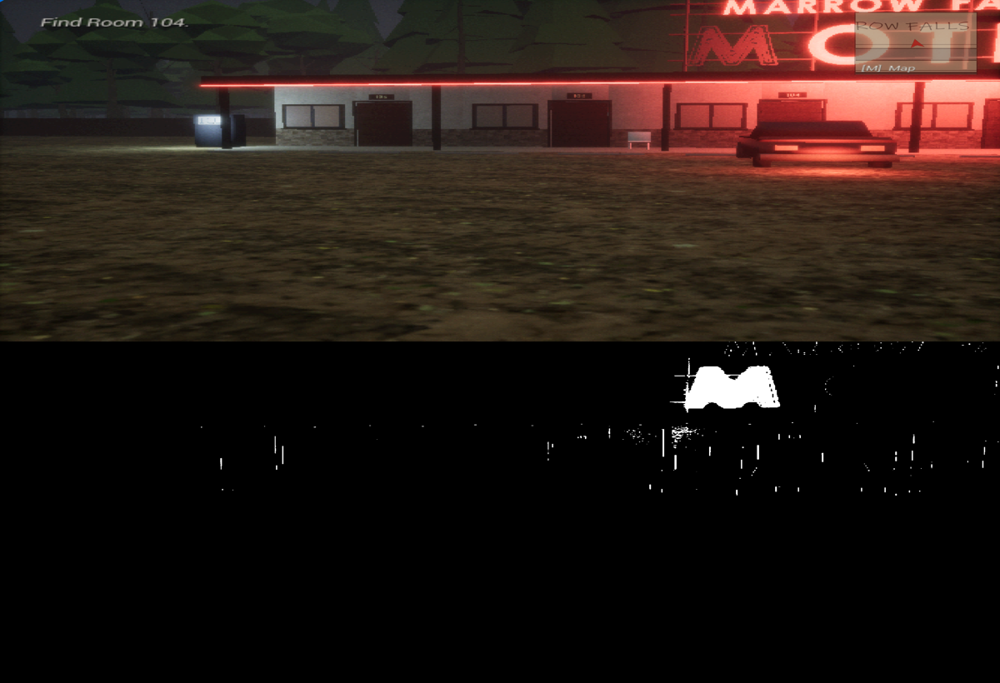

Your note: "I'm talking about all the textures that keep flashing in and out of the screen."
That's **z-fighting**: two surfaces in (almost) the same place, so the GPU can't tell which is
in front and they flash between each other as you move. Found and fixed:
- **Parking lot:** paint lines, cracks, patches and oil stains were 3-6 mm apart and overlapping.
  Now each kind has its own layer, 8 mm apart (stains 0.8 cm, patches 1.6, cracks 2.4, paint 3.2).
- **Road lines** 4 mm above the road: now 1 cm. **Trail** top 5 mm under the lot: now 1 cm.
- **Motel front:** the room side walls and ceilings were flush with the outside wall. Once the
  room insides got their own lighting this morning, they flashed through as dark/red strips.
  They now stop 1 cm short.
- **Room 104:** photos 1 mm off their borders (now 8 mm), bed stains under the sheet, papers/leaves
  on the table, ceiling stains on the ceiling.
- Also off: occlusion culling (objects popping in late at the screen edge when you turn).

Test: two screenshots 2 cm apart. White = pixels that changed a lot: only outlines moving by a
pixel and the dead "M" (it flickers on purpose). Nothing flashes on the lot or the walls.

### Last flashing: the ground under Room 104 and the lot

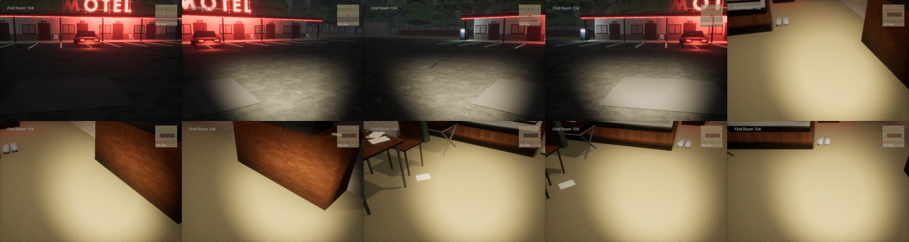

Your note: "it worked except in Room 104 I still see flashing of the ground underneath, and sometimes
the parking lot too." Cause: the PS2 vertex wobble snaps vertices to a grid that gets coarser with
distance. The ground is one giant flat piece whose corners are up to 200 m away, and vertices behind
the camera counted as "corner", so they were snapped by up to ~12 cm. That tilted the whole ground a
little, enough to poke up through the carpet (2 cm above it) and the lot (3 cm) now and then.
Fix: the wobble only moves vertices in front of you, by at most half a centimetre. Test: turning in
Room 104 and on the lot, no ground shows through.

### Room 104: last three flickering spots

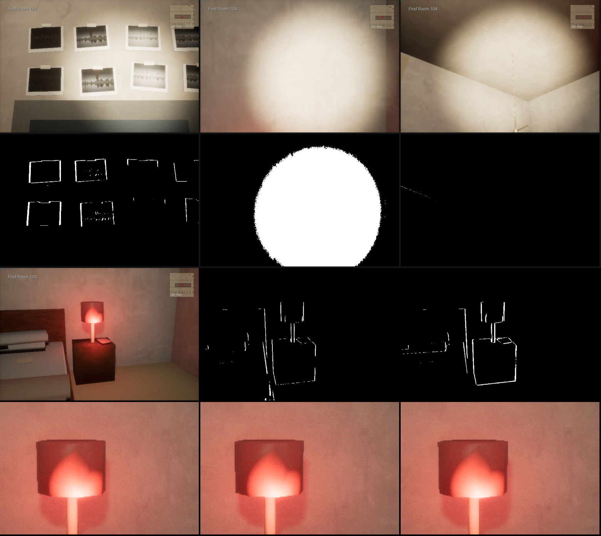

Your note: "it's just on one of the photos in Room 104, the top of the lamp, and a weird white thing
in the top right corner." All three were z-fighting:
- **Photo:** the red-lanterns photo was placed exactly on top of another photo in the grid. Moved to
  the empty fourth spot in the top row (now 8 photos, 4 + 4).
- **Lamp top:** the red shade was built over the room's normal shade with the caps at the same height.
  It's now a little bigger in every direction.
- **White thing:** the cobwebs, flat triangles, one lying right on the wall. They didn't read as
  cobwebs anyway, so they're now thin grey strands strung across three top corners, 1.5 cm off the walls.
Test: two shots 1 cm apart; white = changed pixels, only outlines (the big circle in the middle top
row is the flashlight flickering between the two shots).

## 2026-11-05: Room 104 detail pass

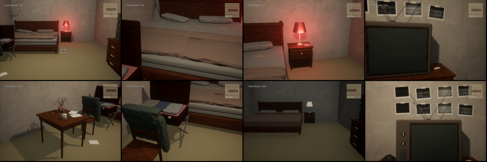

Your note: "all of the objects look way too low poly, I want them to have a lot more detail."
New `maya/room_props.py` builds the furniture from richer shapes (bevelled boxes, smoothed soft
shapes, tapered cylinders, spheres) for all six rooms: panelled bed on legs with a rounded mattress,
nightstand with drawer and knob, lamp with base, bulb, tapered lined shade and finial, dresser with six
drawers and bar handles, an old CRT TV (curved screen, knobs, grille, rabbit ears). Room 104: diary,
mug, plant, table, slatted chair, suitcase, camera rebuilt. Motel: 39k -> ~160k triangles.

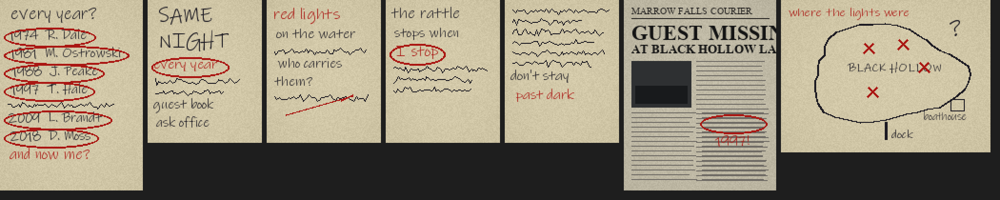

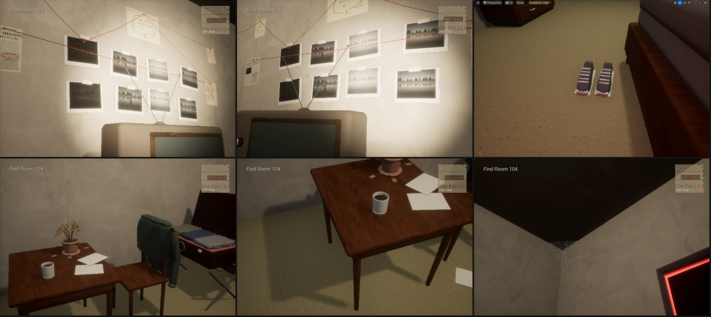

Your notes: the sneakers still looked weird, the jacket too, no coffee in the mug, the plant could be
more detailed, the blank "pages" on the wall should have scribbles like she was investigating, a
weird item on the left wall, and cobwebs more noticeable and not in every corner.
- **Investigation wall:** the blank "pages" were my peeling-wallpaper strips; gone. Around her lake
  photos are now her notes (drawn by `tools/make_photos.py`: years and names circled in red, "same
  night every year", "red lights on the water", "the rattle stops when I stop"), a newspaper clipping
  ("GUEST MISSING AT BLACK HOLLOW LAKE", 1997 circled), her hand-drawn lake map with red X's, red pins
  and red string between them. Also fixed: all pictures had been upside down.
- **Sneakers:** built from a real side profile (heel collar, tongue, low toe), dark canvas, white
  sole, toe cap and laces.
- **Jacket:** a two-sided draped cloth over the chair back with folds, a collar and two sleeves.
- **Mug:** open top with a lining and rim, coffee 2 cm down. **Plant:** saucer, rolled rim, lumpy
  soil, nine curving drooping stems with curled leaves.
- **Left wall:** the "weird item" was the water streak (two flat slabs); removed.
- **Cobwebs:** one big web in the back corner over the bed, one small one over the door.

### Note on the bedspread, cleaner bed and wall, written pages, a pen, a patterned carpet

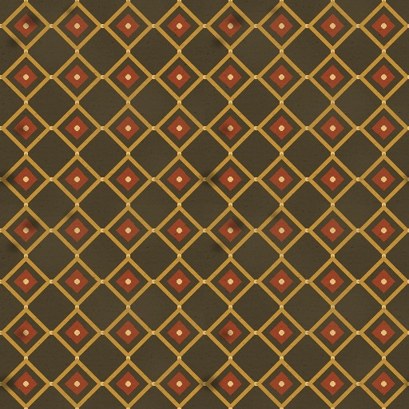
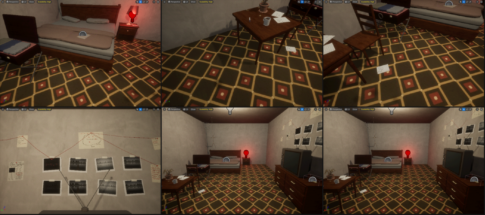

Your notes: move the note onto the blanket, get rid of the shoes, the stains on the bed, the red string
going over the photos and the jacket; scribbles on the papers on the table and floor; a pen on the table;
a pattern on the carpet.
- The note (clue) now lies on the bunched bedspread at the foot of the bed (that lump has a flatter top).
- Shoes, bed stains, jacket and the string across the photos removed.
- The torn pages are her diary pages (ruled lines, red margin, torn edge, handwriting), and a ballpoint
  pen with its cap and clip lies by the mug.
- Carpet: `tools/make_carpet.py` draws a worn 70s motel pattern (mustard diamond lattice, rust
  centres, dots on dark olive-brown) woven into the photo carpet so it still looks like pile; tiles
  seamlessly, one repeat per 1.6 m, toned down so it looks worn. In every room.

### Wallpaper, muted carpet, a real window, a painting

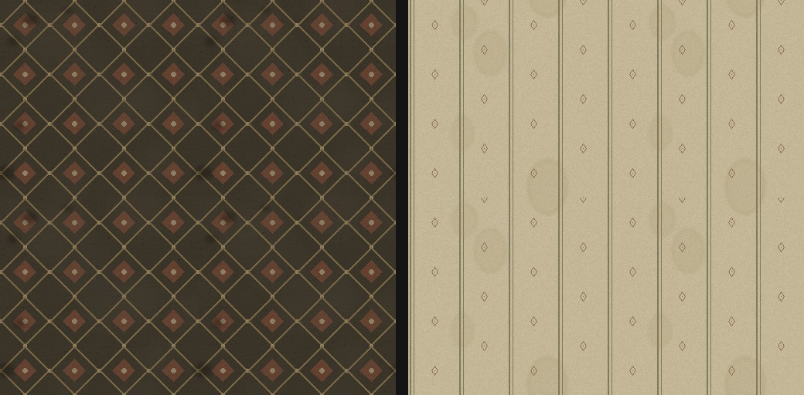
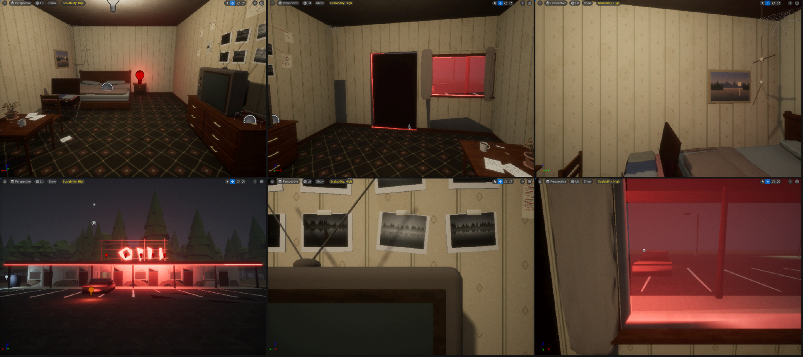

Your notes: carpet too intense, walls look like concrete, add a window over the parking lot, a painting
on the left wall.
- Carpet redrawn in faded colours. Walls: the inside of every room now has old motel wallpaper
  (`tools/make_wallpaper.py`: cream, thin olive stripes, a small motif, water marks) and wooden
  baseboards; the outside keeps its plaster (each wall is two halves).
- Window: a real opening in every room's front wall (where the outside window was), see-through glass
  (new translucent `M_PS2_Glass`), the outside frame opened up with a middle bar, and inside a sill,
  casing, a brass rod and curtains: pulled back in most rooms, closed and glowing in 102 and 106.
- Painting: a framed sunset-lake landscape over the bed on the left wall.

### What broke the outside, and the fix

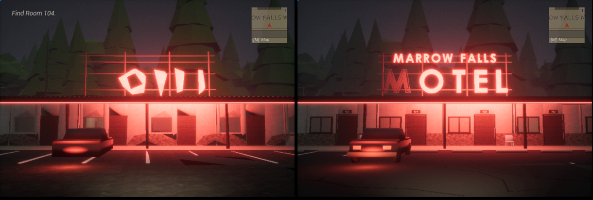

Your note: "you just ruined the whole outside of the motel and parking lot." Left: how it looked;
right: how it should look. The Maya model was fine (same faces as before). Cause: with the motel mesh
now ~4x bigger, Unreal's import switched on **Nanite** (automatic mesh simplification), which
crushed the thin sign letters, window frames and flat lot details (only 3,367 vertices were left).
Fix: `import_sets.py` turns Nanite off on the motel meshes every import.

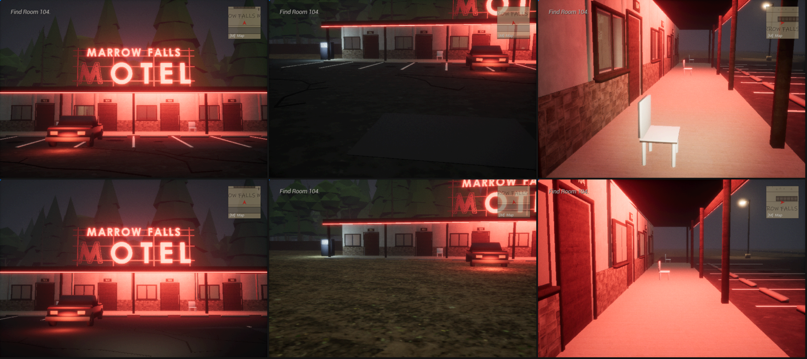

Top: now. Bottom: earlier today. Motel front, lot and walkway match again (plus the new windows).

### Ceiling fan light, a real bedspread, floor-length curtains

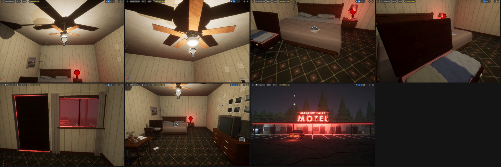

Your notes: make the ceiling lamp higher poly and a fan light, the blanket more realistic, the
curtains all the way to the floor.
- Ceiling fan with a light kit in every room (canopy, downrod, motor housing with a brass ring, five
  wooden blades on brass irons, frosted bowl, pull chain). Room 104's bowl glows and the room light
  now sits just under it. (The bulb shape in these editor shots is only Unreal's light icon.)
- Bedspread: one piece of cloth instead of lumps. It lies over the foot half, hangs down both sides
  and over the foot with folds, and is turned back on itself in a loose roll; the note lies on it.
- Curtains: pleated cloth from the rod down to the carpet (closed and glowing in 102 and 106).
- Outside checked after the rebuild: unchanged.

### Curtains clear of the frame, a smoother blanket, detailed clothes

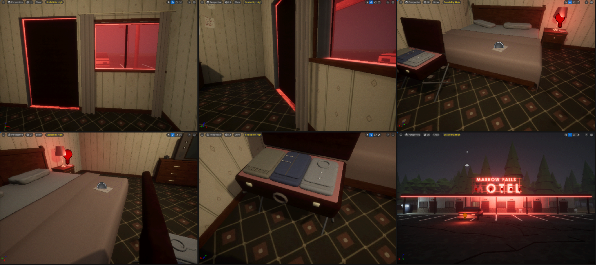

Your notes: the curtains went through the wooden window frame, too many lumps on the blanket, the
clothes in the suitcase should be higher poly.
- Rod and curtains moved forward, in front of the sill, on brass brackets.
- Bedspread: only a few broad, gentle folds.
- Suitcase: three properly folded garments (smoother, two layers and a rounded fold): a sweater with a
  ribbed hem, jeans with a centre seam and stitched back pocket, a shirt with collar, placket and buttons.

### Better clothes, no circles on the ceiling

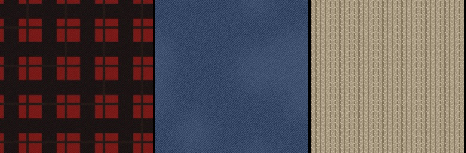
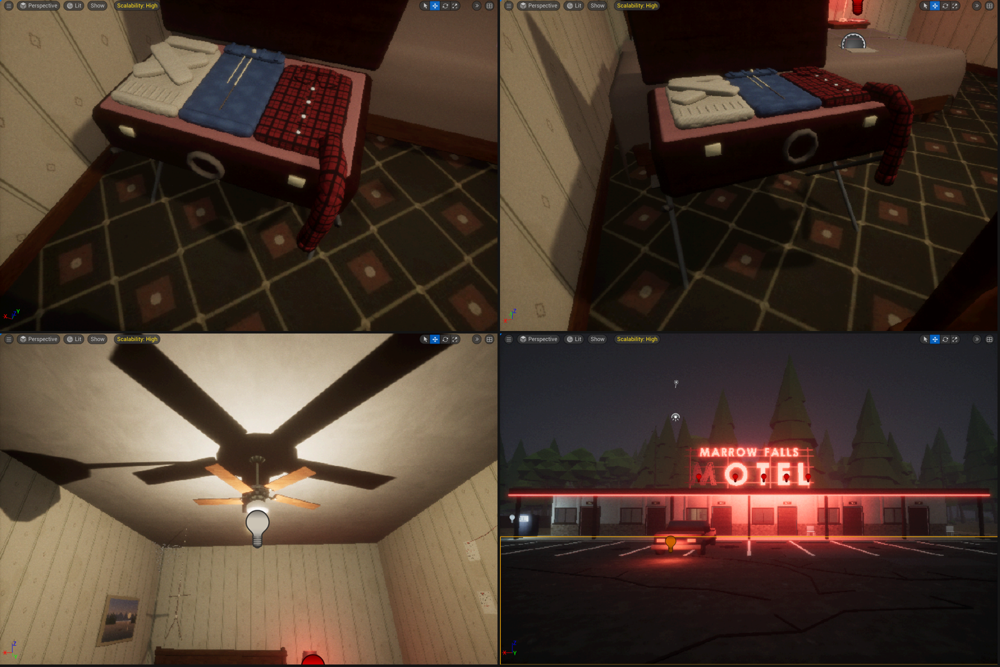

Your notes: make the clothes better, get rid of the weird circles on the ceiling.
- The circles were the water-stain discs on the ceiling: removed.
- Clothes now have real fabric (`tools/make_fabrics.py`): a red/black flannel shirt with a proper
  collar, placket, buttons and one sleeve hanging out over the front of the case; denim jeans with a
  waistband, belt loops, button and fly stitching; an oatmeal knit sweater folded with its sleeves
  crossed and a ribbed hem. (Flannel redrawn once: the first version was mostly black.)
- Outside re-checked after the rebuild: unchanged.

### The diary, pillows, closed curtains

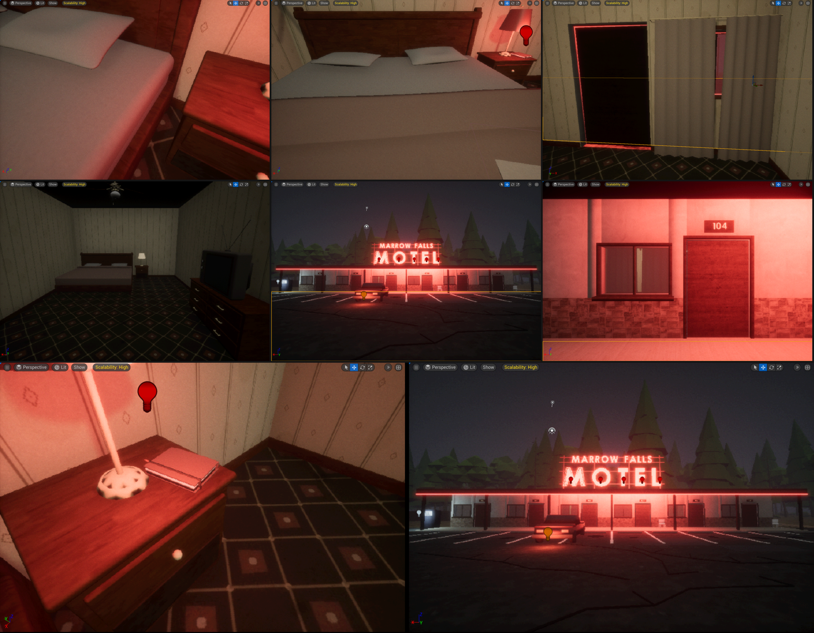

Your notes: fix the journal (wonky), make the pillows look better, close the curtains so you only see
a little out of Room 104, and close every other room's curtains.
- Diary: the spine was placed on the wrong side once the book was turned, and the pages weren't turned
  with it. Rebuilt in the book's own frame: covers, page block, rounded spine, torn-out stubs, an
  elastic strap and a red ribbon bookmark.
- Pillows (every bed): plump in the middle, pinched at the seam and corners, a soft head dent.
- Curtains drawn in every room (102 and 106 still glow); Room 104's leave a 16 cm crack to look out.
- Also: the bedside lamp's base showed dark speckled facets (two stacked pieces cutting into each
  other); it's now one smooth turned piece (`lathe()`), and the fan housing parts no longer share faces.

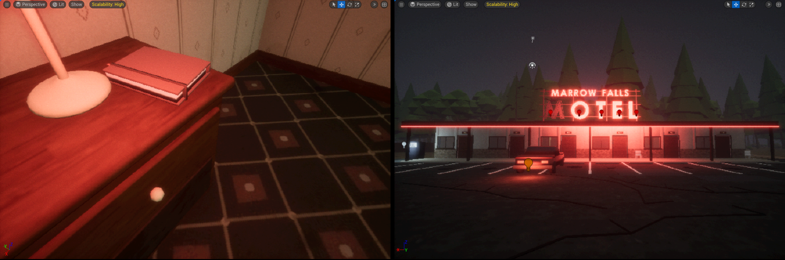

## 2026-11-05: Life around the motel, stage 1 (bugs, bats, flock)

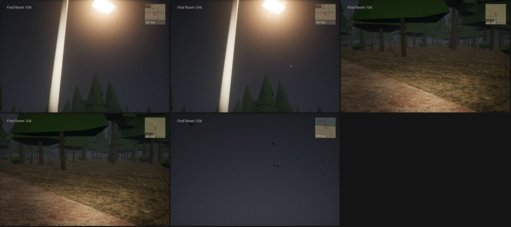

Your idea: a black cat around the motel (sometimes seen elsewhere), birds, little bugs in the air.
You picked: the cat wanders and watches; crows, an owl, bats and a flock overhead; moths at the
lights, fireflies in the woods, gnats/dust.
Stage 1: `maya/make_critters.py` builds a moth, firefly, gnat, bat and flock bird; `unreal/critters.py`
places 30 moths at the outside lights, ~190 fireflies along the trail and lake shore, 8 gnat clouds,
10 bats (lot lamp, streetlight, over the lake) and a flock of 12 over the dock. They move with no
Blueprint logic at all: `M_PS2_Critter` (a copy of the PS2 surface material) moves each one along its
own looping path in the vertex shader, turns it to face where it's going and flaps its wings;
fireflies blink. Shots: a bat moving between two frames by the lot lamp, the woods, the flock.

## 2026-11-05: Life around the motel, stages 2 and 3 (crows, owl, the black cat)

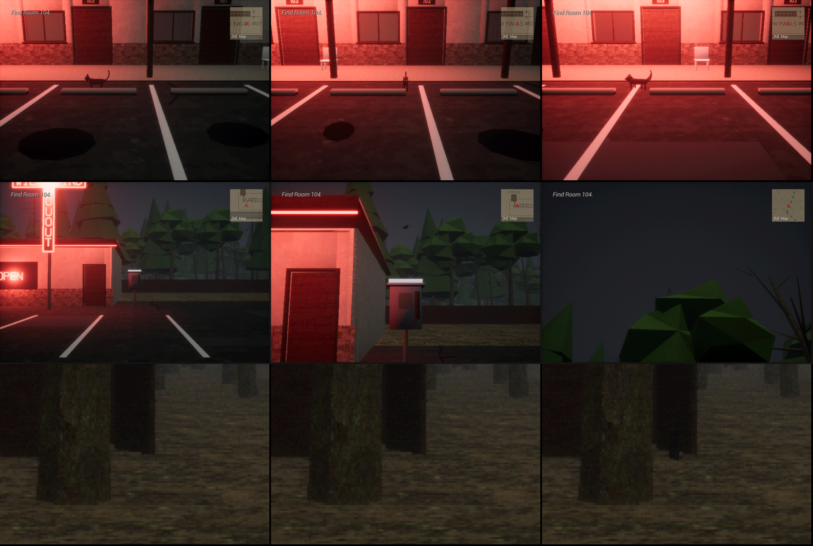

Row 1: the black cat on its walk along the front of the lot (walking, sitting and staring at you,
walking). Row 2: the payphone crow from 13 m, then flying off when you get within ~5 m; the owl's spot.
Row 3: a "watching" cat by the shack: there in one shot out of three (they only show up now and then).
- The HUD now tells the materials where you are every frame (`MPC_Horror.PlayerPos`).
- 15 crows on the lamps, streetlight, payphone, dumpster, roof and fence: they lift off and fly away
  as you come within ~9 m and drift back after you leave.
- An owl with glowing yellow eyes on a dead tree off the trail; its head turns in little jerks to watch you.
- The black cat walks a loop round the rooms (18 s walking, 7 s sitting and staring at you), bolts
  away if you come within 4 m, and is gone if you get right up to it. Seven more sitting cats wait at
  the trail, the shack, the car, the tower, the dock, the cabins and the boathouse: each shows up only
  part of the time, only when you're between 11 and 45 m away, always facing you; its eyes shine
  green when you look straight at it.
All of it runs in the vertex shader of `M_PS2_Critter` (no Blueprints).

### The cat, take two: higher poly, a slow elegant walk

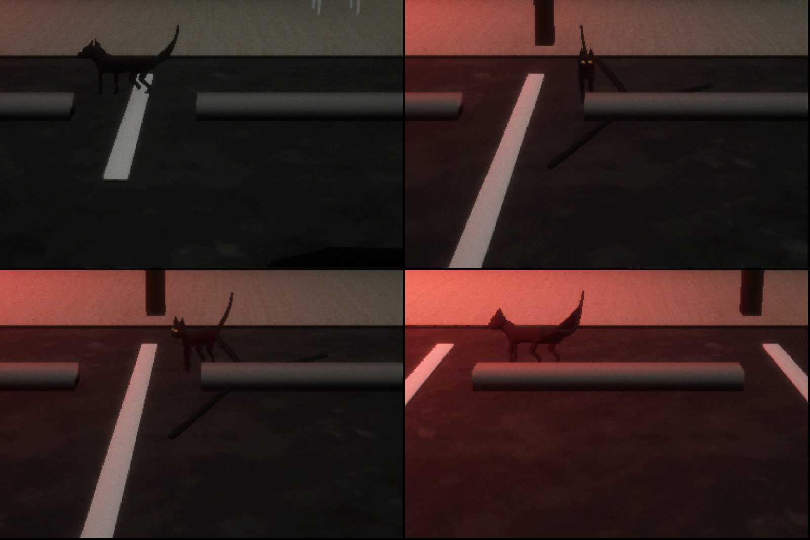

Your note: "make the cat higher poly, he looks really bad, give him a slow elegant and mysterious walk."
- Model (~20k triangles): one smooth torso (rounded haunches, narrow waist, deeper chest), a neck, a
  round head with cheeks, muzzle, nose, pointed ears and almond eyes, slender jointed legs (the back
  legs bend backwards at the hock like a real cat's), paws, a long tapering tail that rises and curls.
- Walk: ~30 cm/s; each leg lifts and reaches in a cat's walking order and the steps follow the
  distance walked, so the paws don't slide; a soft bob and sway; the tail waves slowly from base to
  tip; it turns its head to keep watching you as it walks (shots 2 and 3, eyes shining); every 22 s it
  sits for 10 s and stares. The watching cats use the same new model, sitting.

### The cat, take three: your Fab black cat

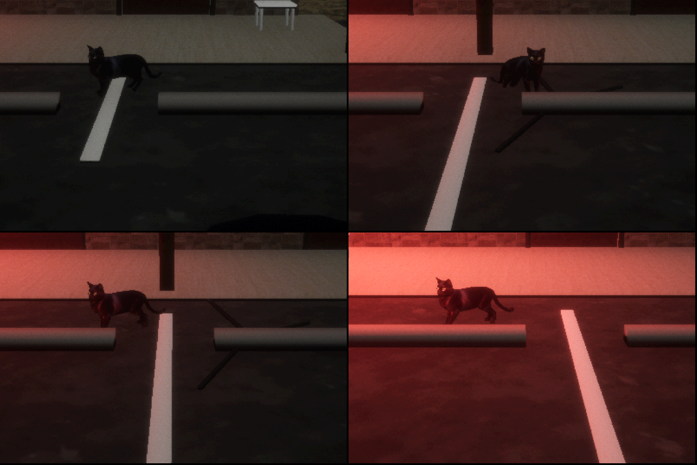

Your note: "I just added a black cat from Fab to the project, I want a cat like that." Now the walking
cat and the seven watching cats are your Fab model ("Black Cat, available for 3D printing", ~64k
triangles, its own colour and normal textures), scaled to 75% so it's cat-sized, and driven by the same
slow walk as before (legs, body bob, tail wave, head following you, sitting to stare). Its eyes are
only painted on, so a small pair of glowing eyes is added on top for the eyeshine.
How: `M_PS2_Critter` got a "UVMode" switch that uses a model's own UVs and normal map instead of the
PS2 world projection, and the walk's leg/tail/head cut-offs were re-measured for this model.
Two fixes along the way: the creature material is now rebuilt under a spare name and the instances
moved onto it (Unreal wouldn't delete the old one while it was in use, so changes weren't applied),
and creatures now move around their true pivot (the eyes had drifted off the head).

### The cat, take four: rigged in Maya with a real walk cycle

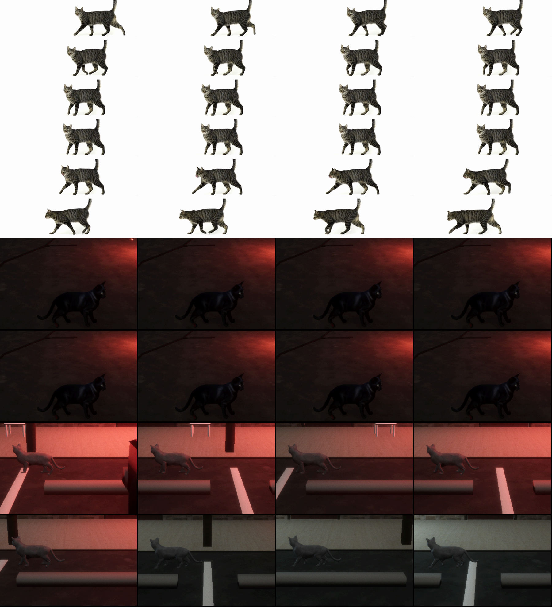

Your note: "the cat's walk is really bad and not natural", then: rig it in Maya (plus your reference video).
The Fab cat was one rigid statue, so the shader could only bend it. Now `maya/make_cat_rig.py` turns
it straight, finds its anatomy in the mesh (feet, leg centres, torso, head, the hanging tail) and
builds a 34-joint skeleton: spine, neck, head, four legs (the back legs bend backwards at the hock),
an 8-joint tail. It skins the mesh (bone-based, tail and leg weights cleaned up) and keys a walk with
IK so the paws plant and never slide: the reference's order (back left, front left, back right,
front right), one stride a second, hips and shoulders rolling, a small bob, the head held level, the
tail hanging with a gentle sway; plus an 8 s idle (breathing, looking around).
`unreal/cat_rig_import.py` brings it in (SK_Cat, A_Cat_Walk, A_Cat_Idle), `unreal/cat_material.py`
gives it the PS2 look, and `unreal/cat_walk.py` makes a looping Level Sequence that walks it round the
motel at ~20 cm/s (matching the stride), stopping at two corners to stand and look around. It starts
by itself with the game.
Top: your reference. Middle: the walk on the spot (quarter speed). Bottom: walking along the rooms.
On the way: raising the tail tore the mesh (the model's tail hangs, so it now hangs and sways), the
first skin gave the back legs to the tail, and a bob key dropped the body to the floor.

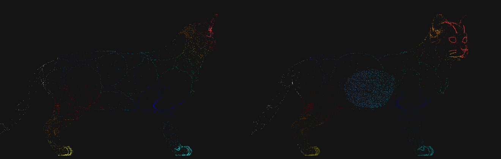

### The cat: removed

Your note: "just get rid of the cat, it looks really bad." The walking cat, its sequence, the seven
watching cats and the rig scripts are gone (they stay in the git history if you ever want them
back). Your Fab download itself is untouched in Content/Fab. The bugs, bats, crows, owl and flock stay.

### Fewer bugs at the lights, bugs around you, many more birds

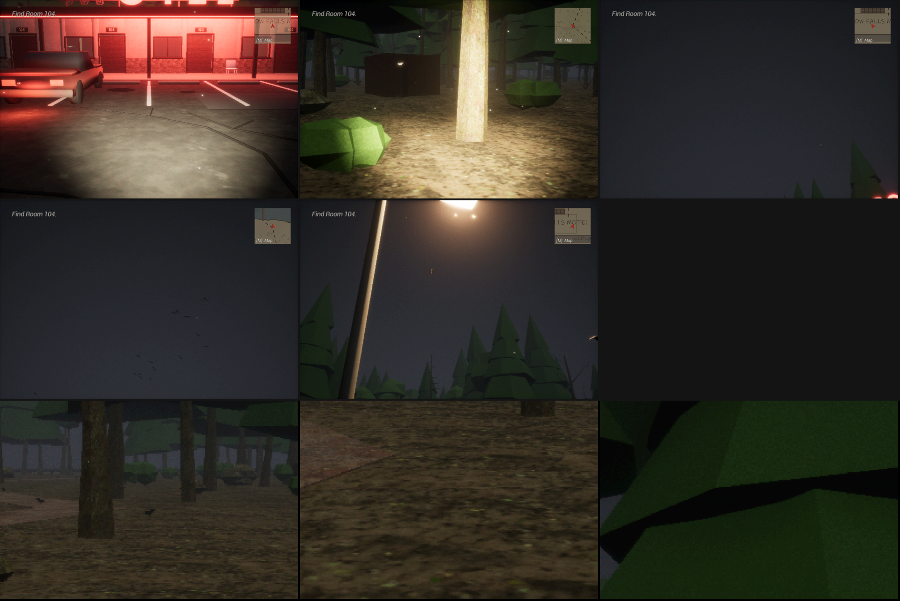

Your notes: only two or three bugs around a light, bugs around the screen, more birds flying and
more swarms in the sky, and birds must fly away when you get close.
- Moths: 2-3 per light (13 in all, was 30).
- Bugs around you: 45 drifting specks and 4 moths in a field that wraps round the player wherever you
  go (a new shader mode), so something is always floating past the camera, mostly seen in the flashlight.
- Birds: 6 flocks (77 birds) circling over the lake, the woods, the motel and the road at different
  heights and speeds, plus 8 crows gliding low in wide circles; 35 perched crows (15 on lamps, roof,
  fence, payphone, dumpster; 20 on the ground along the trail and at the clearings).
- Fly-away: perched crows lift off from ~12 m (was 9), and any flying bird you walk under climbs away.
Shots: specks in the lot and woods, the lake flock, two moths and a bat at the lot lamp; bottom: two
crows on the trail from 18 m, gone when you walk up.

### Smaller bugs, hardly any glow

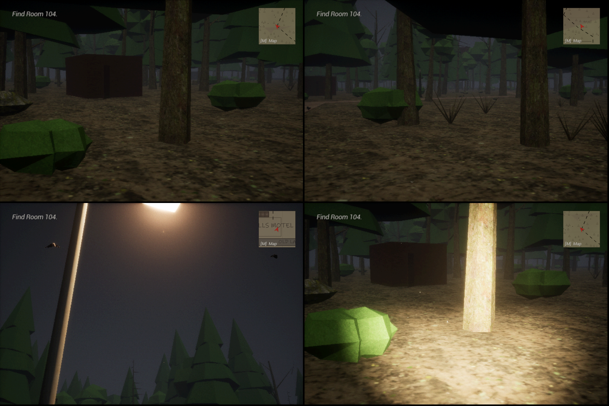

Your notes: make all the bugs smaller and not glow; only a few with light, and very dim. Moths and
fireflies are half size, gnats 60%, the floating specks a third of before; moths, gnats and specks are
darker so they don't read as glowing dots. Only about 1 firefly in 8 (26 of 192) still glows, at a
twentieth of the old brightness; the rest are plain dark bugs.

### Bugs don't shine in the flashlight

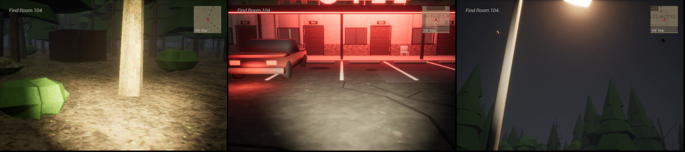

Your note: "make them unaffected by the flashlight, it's making them glow." The bugs (moths, fireflies,
gnats, the floating specks) are on lighting channel 2 only; the flashlight lights channels 0 and 1, so
the beam passes over them and they stay dark little shapes in the night light. Birds are unchanged.

## 2026-11-05: Motel outside, detail pass

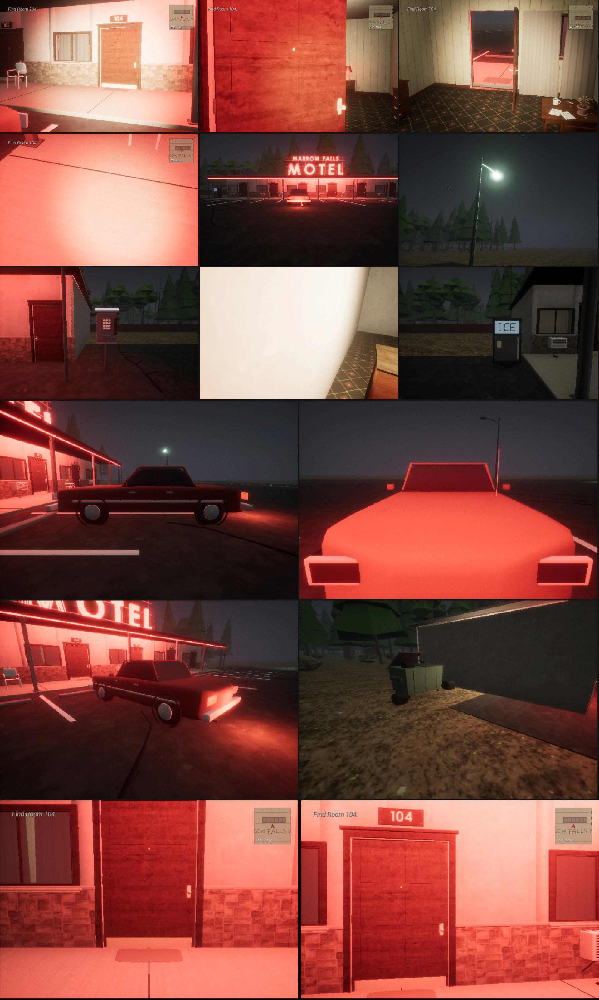

Your notes: the sign is perfect, leave it; everything else outside more high poly and detailed,
including the parking lot and the car; make all the lamp posts the cool colour of the one on the left.
New `maya/exterior_props.py` (rooftop sign and neon cross untouched):
- Room fronts: brick base with a concrete cap, stepped door casings with a cornice, framed windows
  with inner stops, a middle bar and a sloped sill, number plates with screws, through-wall AC units
  (louvres, vents, brackets, a drip stain) under four windows, doormats.
- Doors: real panelled doors (six raised panels each side, brass knob and backplate, peephole, kick
  plate, hinges) replace the plain slabs; they still swing on E (`place_clues.py` uses the new mesh).
- Awning: a rippled corrugated roof, fascia, gutter and downspouts, steel posts with base plates,
  bolts and knee braces, walkway expansion joints. Plastic patio chairs with slats, arms and feet.
- Office: brick cap, door cornice, window mullions and sill, gutter. ICE machine: bevelled cabinet on
  legs, lit sign, steel door with handle and hinges, vent, coin plate.
- Lamp posts: concrete footing, bolted flange, tapered pole, curved arm, cobra head with a lens; all
  in the streetlight's cool green-white (the dead lamp stays dark).
- Payphone: keypad, coin slot, return chute, handset on its hooks, armoured cord, shelf, lit hood.
  Dumpster: tapered body, ribs, lifting pockets, one lid propped open on a bag, castors, more bags.
- Parking lot: bevelled wheel stops with rebar pins, a bevelled curb, a storm drain, a manhole cover,
  weeds in the cracks and along the curb.
- The car: a shaped sedan body (sloped nose and trunk), glass greenhouse with pillars and a roof
  panel, tyres with hubcaps, chrome bumpers and side trim, a grille, headlights and red tail lights,
  mirrors, door seams and handles, wipers, plates, an aerial, an exhaust.
Motel: ~255k -> ~333k triangles.

### Door gap, a higher-resolution car and dumpster

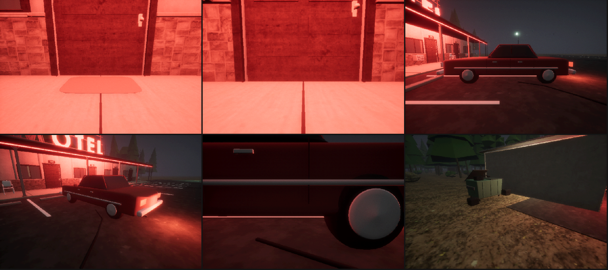

Your notes: a gap under the doors, the car and the garbage bin higher resolution.
- The "gap" was the brass kick plate: the only light part of the door, right where it meets the
  walkway. Removed, and the doors are 3 cm taller so they tuck into the frame.
- Car: body and cabin built from twice as many cross-sections and smoothed twice; tyres with
  rounded sidewalls and tread (48 sides), dished hubcaps (40 sides) with five lug nuts, rounder
  bumpers, pillars, roof, mirrors and exhaust.
- Dumpster: well-rounded body edges, ribs front and back, lifting pockets with a rim, rounder lids
  with hinge rods, smoother castors and bags.
Motel now ~515k triangles (most of the new ones are the car).

### A more realistic parking lot and car

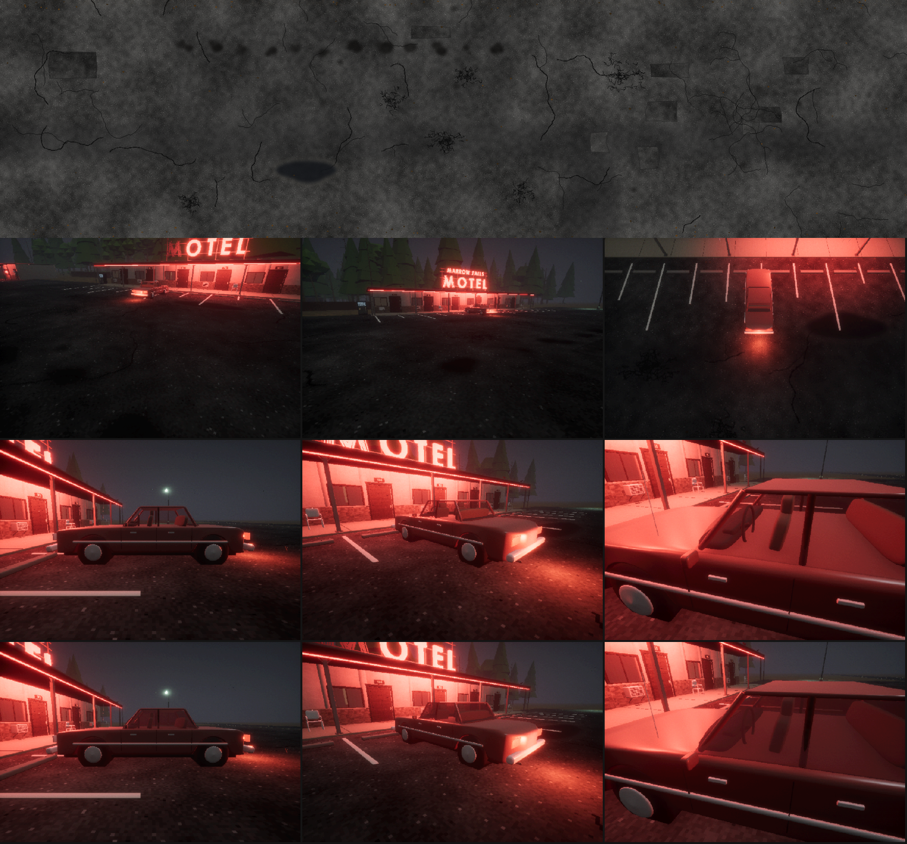

Your note: "make the parking lot look most realistic, and the car too."
- Lot: one large painted asphalt surface instead of scattered crack and stain pieces
  (`tools/make_asphalt.py`, ~4 cm per pixel, top image): aggregate grain and tone variation, darker
  worn lanes into the stalls, an oil stain under every stall, branching cracks and crumbling
  alligator cracking, repair patches with irregular edges and sealed seams, a puddle with a dried
  rim, grit and dead leaves along the curb and the walkway. The road got the same (worn tyre lanes,
  patches, cracks). The painted lines, wheel stops, drain, manhole and weeds sit on top.
- Car: real wheel arches cut into the body with dark wheel wells, a dark underside, a slightly
  glossy paint and chrome (new `M_PS2_Gloss`), tinted glass you can see the interior through (front
  seats with headrests, rear bench, dashboard with a gauge hood, steering wheel, parcel shelf), and
  real number plates ("4KJ 219").

### Your car: the Fab classic car

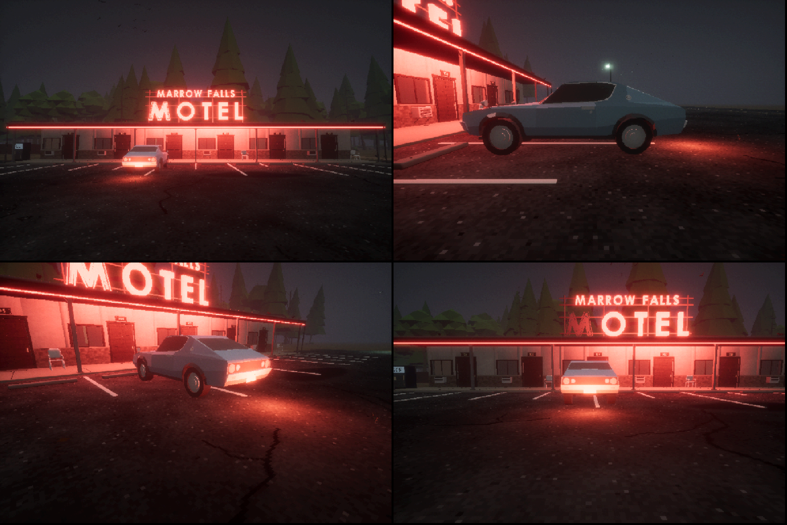

Your note: "I added a car from Fab, replace the car with that one." The Maya-built sedan is out of the
motel build; `unreal/place_car.py` (a build_level step) puts your Fab "Low-Poly Classic Car (Free)"
in the same stall in front of Room 104: turned so the nose faces the motel (its front is at its local
-x), lifted so the wheels sit on the asphalt (its pivot is mid-body), centred on the stall, with
collision so you can't walk through it and Nanite off. The red tail-light glow on the asphalt stays.
The model stays in Content/Fab (your download), not in this repo.

## 2026-11-05: Black Hollow Lake

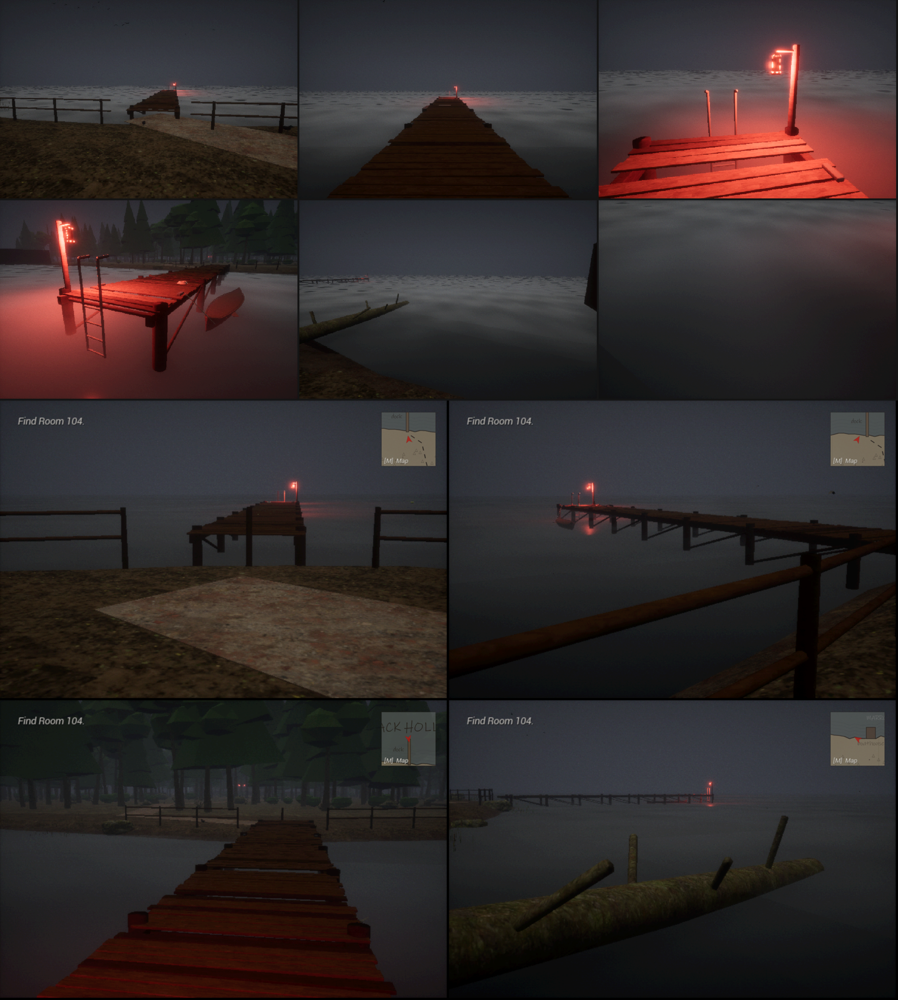

Top: first pass (the water read pale grey, like fog). Bottom: now.
New `maya/make_lake.py` (exported as its own set, `export/sets_lake.json`, which `import_sets.py`
now merges with the motel's):
- A real shore: one ground sheet sloping down into the lake along a wavy edge, with a point of land at
  the dock so the trail ends on solid ground; dry forest floor, wet mud at the waterline, a dark bed.
  The flat blockout ground now stops at the shore, and the old black lake plane and box dock are gone.
- Water 45 cm below the shore: dark, a faint slow ripple, a little gloss so the dock lantern lays a
  red streak on it (`M_PS2_Water`). Low mist banks drifting over it, fading where they meet the
  ground (`M_PS2_Mist`).
- The dock: weathered planks with gaps (a few missing, one broken and sagging), stringers on pilings
  with cross bracing, cleats, a coil of rope, a swim ladder going down into the water, and a red
  lantern on a post at the end (its light reflects on the water: the red-light theme).
- A split-rail railing along the shore where the trail comes out, with a gap onto the dock; the red
  canoe moored by the dock with a line to a cleat, a paddle inside; reeds and cattails along the edge,
  rocks, and a fallen tree lying out into the water.
Boathouse and cabins come next (their own plan rows).

### 2026-11-05 — Lake fixes: low dock, rowboat, wavier shore

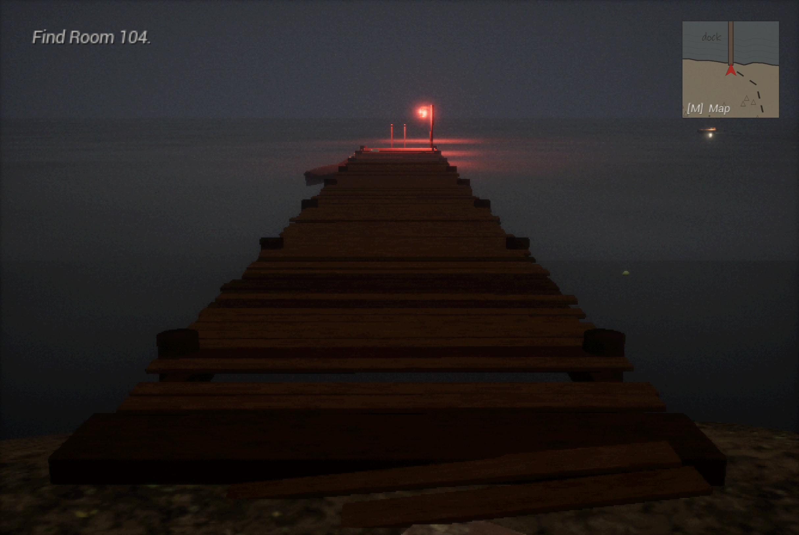

The dock was 50 cm above the trail, so you couldn't step onto it. Now it sits just above the ground (deck at 16 cm) and starts on dry land, with a timber sill and two worn boards bridging the step. A railing post that stood in the middle of the dock entrance was moved to the sides of the opening. While testing I found the player could walk on top of the low mist and on the water. The water and mist are now a separate mesh with no collision, and invisible walls run along the knee-deep line of the shore and the dock's sides and end, so you can walk the dock but not into the lake.

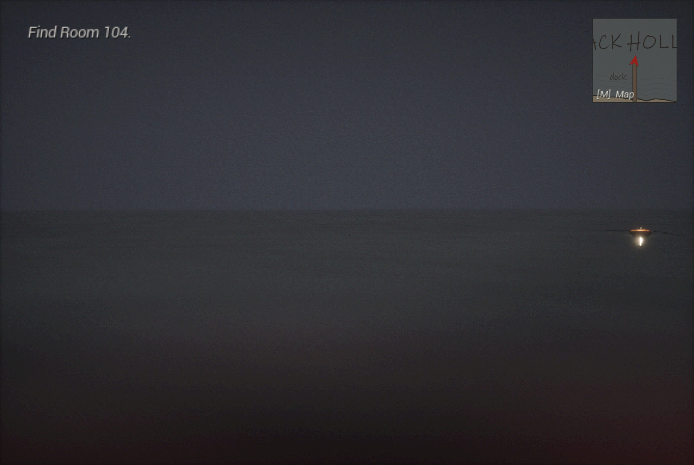

An empty rowboat far out on the lake (about 35 m from the end of the dock), one oar trailing in the water, with a very faint lantern so you can only just make it out through the mist.

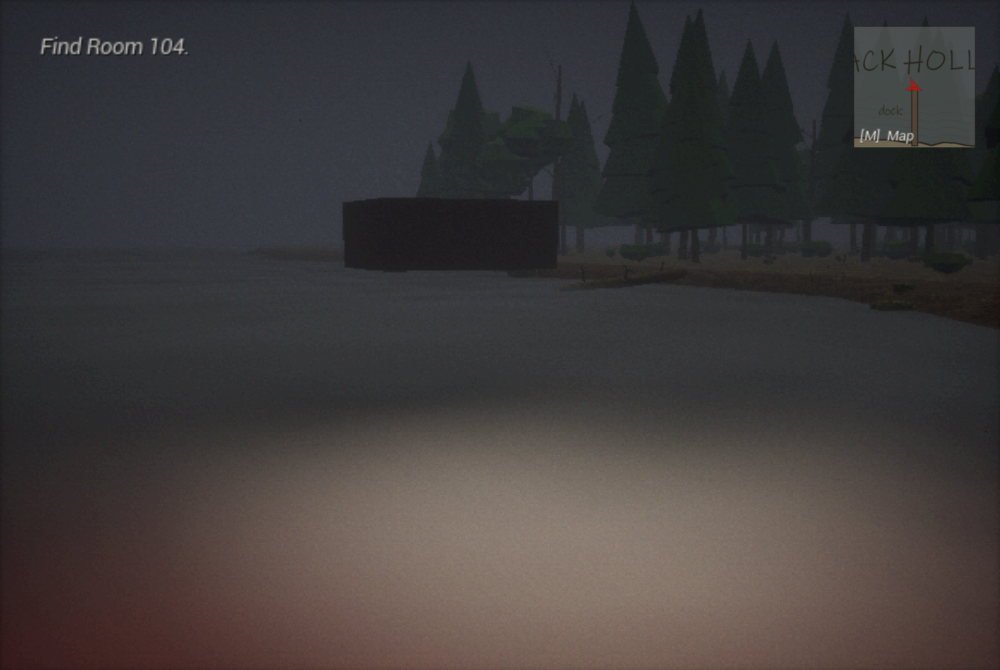

The water's edge now goes in and out in small coves and points (two more, shorter waves added to the shoreline curve), instead of one long smooth bend.

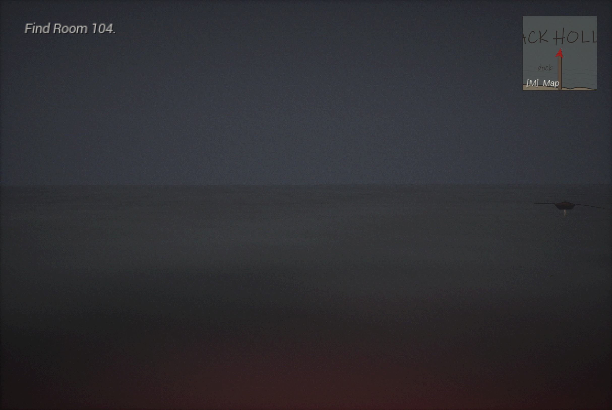

Rowboat lantern turned down until it's basically off: the glass is no longer glowing and the light is at 0.3. Even at 3 the glossy water still showed a bright streak under the boat. Now it's a dark shape with the smallest glint.

### 2026-11-05 — Boathouse and the three cabins

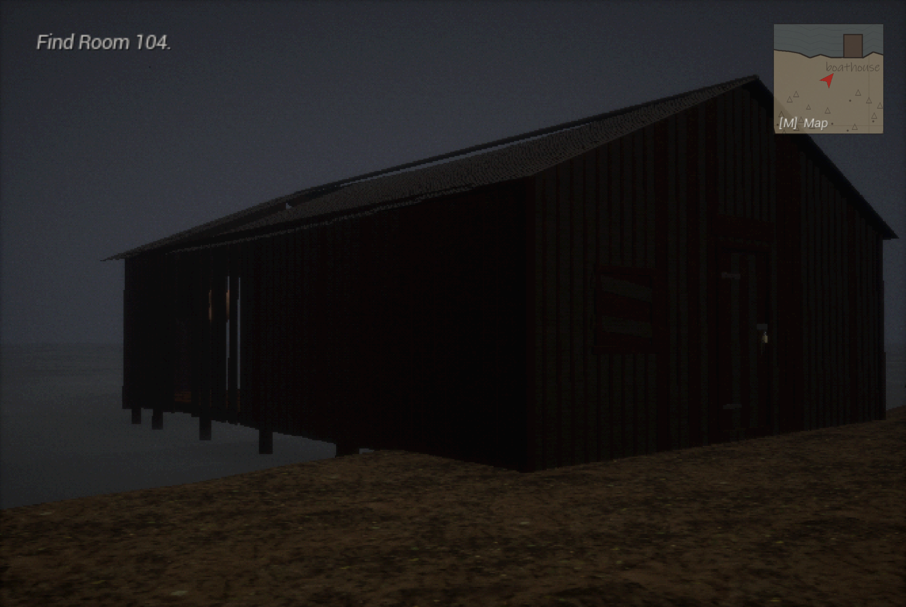

The boathouse, half over the water west of the dock (maya/lake_buildings.py). Grey board-and-batten walls, a rusted tin roof that sags in the middle with a loose panel and a hole near the lake end, pilings standing in the water. The lantern inside glows through the gaps at the lake end.

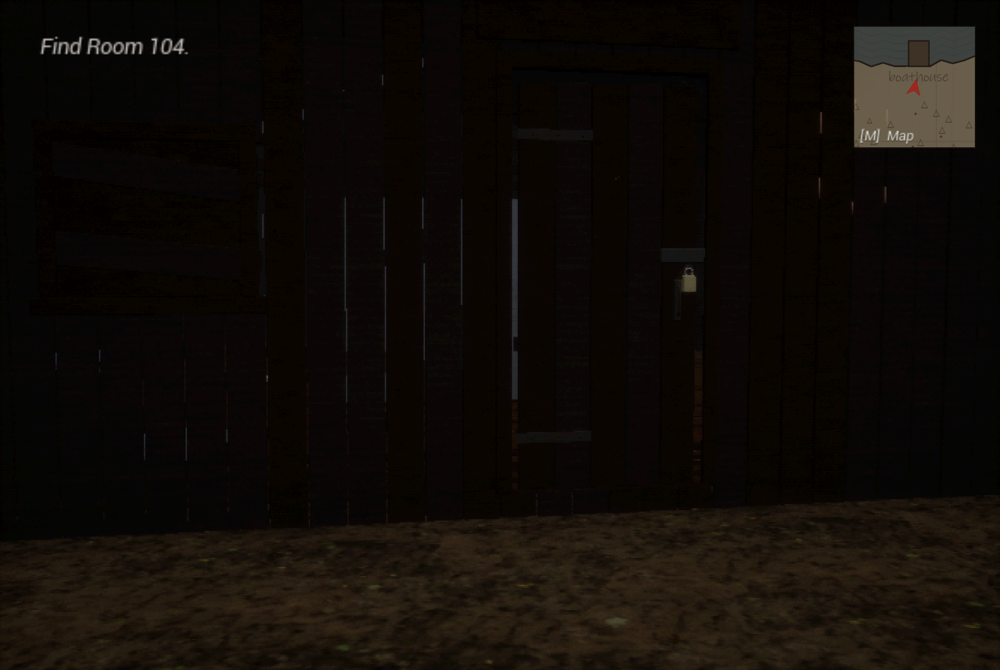

The way in from land: a plank door with strap hinges and a hasp with a new brass padlock. It needs the boathouse key ("Padlocked. The lock is new. Everything else here is rotting."), so it's abandoned, locked, and recently used all at once.

Inside: the workbench with a vise, hammer, wrench, a can of nails and a saw on the wall, and the signs someone was here recently: an open red toolbox and a kerosene lantern still burning low (a small warm light). The boat slip runs down the middle (you can't fall in, invisible walls).

The east walkway: muddy footprints from the door to the slip, a new coil of rope, a life ring on the wall, the tarp pulled half off a crate, and the half-sunk rowboat in the slip.

The cabins are log cabins on stone piers, porches facing the lake, with shingle roofs, railings and two steps. Cabin 2 (nearest the dock) is the one you can go into: grimy glass in the windows, one boarded from inside, a stove pipe through the roof, and a plank door that opens.

Cabins 1 and 3 are boarded up: the door nailed shut with boards across, every window boarded (with a dark backing so you never see into an empty house), a stone chimney, a missing row of shingles, broken porch boards, a chair tipped over.

Inside cabin 2 (all on the room lighting channel, so only the flashlight lights it): a bunk bed with Cas's green sleeping bag and a rolled flannel for a pillow on the bottom bunk, her backpack on the floor.

The table with Cas's lake map (the boathouse marked) and a torn page, a candle stub, a tin cup and matches. The boathouse key (test clue) lies on the map. Also a wood stove, a rag rug, a shelf of cans, a hanging lamp and cobwebs.

Fix found on the way: since the lake got its own set file, the import had stopped passing on which meshes are "room insides", so Room 104's insides had lost their own lighting channel. The import now merges that list too.

### 2026-11-05 — More realistic bedding, boathouse and boats

The boat in the boathouse looked underwater: I had sunk it on purpose, and the inside of every hull was really a solid block, so they looked filled up. Now the hulls are truly hollow (an outer shell with the top cut away plus a thinner inner shell facing in), the boat floats, tied off at the bow, and you look down into it: ribs, floorboards laid just above the waterline (so the lake never shows inside), seats, oarlocks, keel, stem, transom, an oar and a bailing can. The canoe and the far rowboat got the same hollow hull. The plank that sat in front of the boat (meant as a fallen boat door) is gone; the remaining door is now a proper plank door hanging open on its strap hinges, with the empty hinge pins where the other one was.

Cas's sleeping bag: a quilted shell with sewn channels, the top corner unzipped and folded back showing the red flannel lining, the zipper down the side with its pull, the hood bunched with a drawcord, the empty stuff sack at the foot.

Both bunks now have fitted sheets (the mattress ticking showing at the bottom edge) and real pillows, and the top bunk has a grey wool blanket turned down. The bunk was moved a little off the walls so the blanket can hang over the side rails.

The workbench got a pegboard with hanging tools (hammer, screwdrivers, wrench, hand saw, wire, pliers), a proper vise, a jar of screws, a coffee can full of nails, an oily rag, a hand drill, and a cantilever toolbox with both trays open.

New shelves on the east wall: paint cans with drips and handles, jars and bottles, stacked rags, a red gas can, a bucket. Also new: fishing rods and a landing net in the corner, two oars stored across the roof beams, an anchor with its chain, life jackets shaped like vests with straps and buckles, a net with floats hung on nails, the life ring with tape bands and a grab line, a slatted crate with the tarp draped over it, and boot-shaped muddy prints.

The lantern is now a hurricane lantern (tank, burner, glass globe with the flame inside, wire guard, cap, bail handle). From the door you see its glow on the bench.

Plain untextured colours were washing out to near-white in the flashlight, so the new materials all have textures with darker tints now.

## 2026-11-06: boats ride higher, no more "slab"

Feedback: "the boat is still underwater and there's a weird slab of wood behind it". The boats were only about 30 cm above the water with the floor right at the waterline, so they looked swamped. The hulls are now taller, with about 45 cm of side above the water, and the floors sit higher. The "slab" was the flat, squared-off stern of the hull, which looked like a loose board when the flashlight hit it. The boathouse boat and the far rowboat now come to a point at both ends, with a stern post, and the seats were narrowed to fit inside the hull. The canoe was raised the same way.

## 2026-11-06: first pass at the office, the other rooms and the trail

You asked for a first pass at every remaining structure, to review them all together afterwards. These are the shots I checked them with.

**Office** ("someone just left"): front counter with a bell, the open guest book and a pen, and the flap lifted. Behind it are the desk (lamp on, radio on, a cigarette still burning, a coffee mug), the swivel chair pushed back, the key board with 104's hook empty, and a bookcase of old guest books with three red lanterns on top. The lobby has a couch under the window, a coffee table, a coffee station, a brochure rack and the framed photo of red lanterns on the lake. Through a door left ajar is the owner's back room with a cot, a TV that's still on, a hot plate, and a coat and boots. The first shots were too bright and orange, so the lamps were turned down and the wood panelling darkened.

**Rooms** (bottom right of the office sheet is 101): 101 was left in a hurry (spilled suitcase, drawer on the floor, lamp knocked over, teddy bear, key on the carpet). 102 was barricaded and then broken into (dresser dragged to the door, chair tipped over, phone off the hook). 103 is a renovation that stopped (bare bed frame, mattress against the wall, dust sheets, ladder, paint). 105 has water damage (ceiling panel hanging down, debris, a bucket, stains). 106 is the next guest (duffel bag, meal tray, and a red lantern on the nightstand).

**Back gate**: a chain-link fence with barbed wire along the back of the motel. The gate is chained with a new padlock and has a NO TRESPASSING sign. It's a locked door that needs the back gate key; for testing, that key is on the office desk. **Hunter's shack**: board walls, a tin roof, the door hanging off one hinge, a red lantern burning on the porch post. Inside are a cot with a sleeping bag (someone slept here), a candle stub and cans, antlers, an empty gun rack, traps, a pelt and a small stove.

**Rusted car**: an old sedan sunk into the ground, rusted, windows gone, the driver's door hanging open, weeds and vines, its tail lights still glowing red. **Lookout tower**: four braced legs, six flights of stairs with landings and handrails, and a cabin 11 m up with windows all round and a table for a clue. An automated walk climbed all six flights to the top without getting stuck (the first try caught on low braces and a floor joist, both fixed).

Feedback: "the office is too plain, make it higher poly and make it go more with the hotel rooms theme". The office now uses the same striped motel wallpaper and patterned carpet as the rooms, over raised-panel wood wainscoting with a chair rail, baseboards and crown moulding. The window has the rooms' casing, sill, brass rod and curtains. The front door and the back-room doorway are cased in wood. The lobby has one of the rooms' lamps on an end table, a dead plant, the motel painting over the couch, and the rooms' ceiling fan with its light. The furniture is more detailed: a panelled counter with a rounded top and a brass foot rail, a desk built like the rooms' dresser with brass drawer pulls, a tufted couch on turned feet, a coffee table with turned legs, and a bookcase with a plinth and crown.

## 2026-11-07: the rooms, the ceilings, the office back room and couch

Feedback: the back room of the office was odd, the lobby couch faced a wall, the room ceilings looked incomplete, and the rooms were low poly and weird.
- **Rooms (all six):** crown moulding round every ceiling with a finished plaster texture and a smoke detector; a wood casing round the door inside; a closed, panelled bathroom door in the left wall. The made beds now have a fitted sheet, a real draped bedspread turned down below the pillows, and plumper pillows. Every room but 104 also got the motel painting over the bed, a mirror over the dresser, a tufted armchair by the window with a round table, a rotary phone and an ice bucket. Room 104 only got the ceiling, door and trim changes, so Cas's things stay as approved.
- **Office lobby:** the couch is turned around, with its back to the window, facing the counter and the coffee table.
- **Office back room:** now the owner's small living space: a made single bed with a headboard, a rug, an armchair turned to the TV (on, on a low cabinet), a stool with a mug and ashtray, a floor lamp on low, a kitchenette (cabinets, hot plate with a pan, kettle, shelf of cans), a coat rack with his coat and hat, boots, a calendar and a photo over the bed.

Feedback: "the other rooms are missing the ceiling texture that is in room 104". All the rooms already used the same ceiling material. What made 104 look different is that its ceiling fan light is on, so the ceiling is lit evenly and the fan blades cast shadows on it. You chose to turn the fan lights on only in the rooms that already look occupied: 102 and 106 (the ones with lit curtains) now have the same fan light as 104 (top left 102, top right 106, bottom right 104). 101, 103 and 105 stay dark.

## 2026-11-09: fixes from the walkthrough

After the guided tour you listed fixes, all done:
- **103:** the mattress leans on the wall in front of the bed instead of cutting into the frame; the drop cloth on the floor is gone.
- **101, 102, 105, 106:** the mirror over the dresser (it read as a black frame behind the TV) is removed.
- **102:** the two white drag marks by the dresser are removed.
- **105:** removed the fallen ceiling panel, the water under the bucket, the three streaks above the bed, the towel by the dresser and the stain on the bed.
- **Office:** the coffee cups are a proper nested stack on the counter (they floated in a diagonal). The big neon cross in front of the office is gone; a small version hangs on the office's right wall behind the counter, near the coffee machine.
- **Office back room:** the armchair faces the TV, the stool with the mug is on its other side (the floor lamp moved to the TV side), the coat, hat and boots are gone from the rack, and the hot plate and pan are gone from the counter.
- **Rusted car:** the windows are dark tinted glass you can't see through.

Second fix list (Nov 9):
- **Neon cross:** read "YOUOUT" as one word. Now YOU and OUT have a gap between them.
- **Key board:** framed board, brass number plates with 101 to 106 (101 on the left), cup hooks, and real keys (round bow, cut blade with teeth) with a coloured diamond fob each; 104's hook is still empty.
- **Office back room:** the kettle is gone from the counter; the floor lamp has a proper weighted brass base.
- **Office front:** both windows are real openings now (you can see in and out), and there's a second window between the door and the OPEN window, with its own casing, sill, mullion and blinds.
- **Parking lot:** the middle lot lamp, which was off, is now on.
- **Forest car:** it's now the same Fab car as yours in the lot (unreal/place_wreck.py), repainted faded dark green and rusted, with dark windows you can't see through, dark tyres, rusted chrome and rims, sunk into the ground and leaning, with weeds and vines, a fallen branch and drifts of leaves. The Maya-built car is gone. To find the window and tyre material slots I colour-tested them, because the model's slot names don't say which part is which.
- **Boathouse:** the rag on the workbench (it read as a sheet of paper) is removed.

Third fix list (Nov 9):
- **Office back room lamp:** the floor lamp had ended up standing inside the kitchenette counter, so it looked like a stick with no base. It now stands on the floor beside the armchair with its weighted brass base showing.
- **Back room bed:** the blanket is one draped cloth like the rooms' bedspreads, hanging down both sides and over the foot to the floor, turned back near the pillow.
- **Office front:** an OFFICE sign over the door: a dark board on brackets with red neon letters.
- **Abandoned car:** black now (rusted), instead of green.
- **Map:** the red cross in front of the office is gone from the corner map and the full map.

Fourth fix list (Nov 9):
- **OFFICE sign:** the letters were spaced evenly by box, so the narrow I left a gap and it read "OFF ICE". Each letter is now spaced by what it actually covers.
- **Back room:** the floor lamp stands beside the head of the bed.
- **Abandoned car:** the trim round the windows and body is the model's original white again (it had gone rust-gold); the rims stay rusted.

Fifth fix list (Nov 9): the back-room floor lamp covered the calendar, so it moved over toward the TV wall and stays by the bed. The abandoned car's trim (window outline, mirrors, wheel hubs) was too bright in white, so it's now just off black and barely shows against the black paint. A colour test (setting the trim slots to red) showed which parts are trim.

## 2026-11-09: the ground, the lot, and filling the empty spaces

Feedback: the road and parking lot layout were weird, and the scene had big empty spaces. It should feel filled in so that wherever you run, you're still in the scene. You picked forest right up to the road on the far side, and thick trees plus fog at the edges.
- **Parking lot:** it was a huge black rectangle well past both ends of the motel, sitting on bare dirt. Now it covers just the motel's footprint (maya/grounds.py, LOT in make_motel.py). It has a second row of stalls along the road side facing the rooms across a drive aisle, with wheel stops; stalls in front of the office clear of its door; in/out arrows; curbs on every side; and two driveways out to the road. The painted asphalt texture was redrawn to match (tools/make_asphalt.py), and the old grey blockout slab is gone.
- **Roadside:** grass verges with weeds between the lot and the road, gravel shoulders, a ditch on the far side, a dented galvanized guardrail with a section missing, and wooden power poles every 35 m with three sagging wires and a service drop to the office. The lamps moved onto the lot edge and the verge.
- **Forest fill:** 2,535 trees, bushes, dead shrubs, stumps, logs and rocks fill all the empty ground: across the road, both sides of the motel, and down both edges of the map past the scattered woods. They keep clear of the road, lot, motel, trail and lake (tools/make_fill.py writes export/fill.json, unreal/fill_forest.py plants it). Hidden walls behind the outermost trees stop you wandering off; the road disappears into fog both ways.
- **Map:** shows the new lot outline and the new forest.
- The grass verges first rendered as a glowing lime green under the flashlight; they're a dark, dead green now.

## 2026-11-09: real grass that moves

Feedback: the grass shouldn't be a flat texture; it should be real blades with physics that move in the wind and as you walk through.
- **Blades:** maya/make_grass.py builds every blade as a tapered, curving strip (3 triangles: a wide base, a narrower middle, a point), each leaning and bowed its own way. Blades grow in tufts of 9 to 16, green or dry straw, and tufts make patches: thick 4 x 4 m patches (about 3,000 triangles) and looser 8 x 8 m ones for the forest floor.
- **Where it grows:** tools/make_grass_layout.py lays out 1,087 patches: thick on the verges and road edges, in the yard behind the motel, along the trail, in the clearings and on the bank above the lake; looser over the rest of the forest floor; never on the road, the lot, the trail itself, inside buildings or on the shore. The verges under it are soil now instead of the flat grass texture.
- **Movement:** unreal/grass.py gives the grass its own material (M_PS2_Grass) that moves every blade on the graphics card. Wind is slow gusts rolling across the field plus a quicker flutter. As you walk through, blades within about 1 m lean away from you and press down, then spring back once you've passed; it reads your position from MPC_Horror.PlayerPos, which the HUD already updates every frame. The roots stay planted and the tips move most. Top left and top right are the same view a second apart. Bottom left is looking down while standing in the grass: there's a clear circle round your feet with the blades bent away.
- **Cost:** grass further than 45 m away isn't drawn (it's lost in the fog anyway), it casts no shadows and has no collision.

## 2026-11-09: a realistic forest

Feedback, with two reference photos (process/refs/): the trees shouldn't be big blocks but realistic, a mix of dead and alive, full, thinner and leafless; the grass was placed oddly (on concrete in places), it should only be in the forest; and you got stuck walking through the grass.
- **What the references show:** tall straight dark trunks close together, the crowns high overhead, bare trunks below them (spruces with dead stubs); a spruce wood and a beech wood; ferns, grass and leaf litter on the floor.
- **Trees** (maya/make_trees.py, eight kinds under the old names so every placed tree turned into a new one): full spruce, taller thinner spruce, full beech, thinner beech, a dying tree with a few brown leaves, two bare dead trees (one with its top snapped off), and a dead spruce with a few rust-brown sprays. Trunks and branches are real tapered tubes that fork into limbs, branches and twigs, with a root flare at the base. Leaves and needles are cards: flat panels carrying a leaf-cluster, pine-spray or fern picture with a see-through background (tools/make_foliage.py), two crossed per spot. Their normals point out from the middle of the crown so the foliage lights like one mass. Each tree collides only at the bottom of its trunk.
- **Forest floor:** the blocky green bushes are now fern clumps and the dead shrubs are twiggy bushes with a few brown leaves; you walk through both.
- **Grass:** now only on forest ground, as one even carpet: none on the road, verges, lot, yard, any concrete, the trail itself, round buildings or down the lake shore. The forest-fill dressing follows the same forest-only rule. Getting stuck: the grass patches (and the bushes) had solid collision, because my "no collision" setting hadn't stuck; they're truly walk-through now (tested by walking straight through thick grass).
- **What went wrong on the way:** at first every leaf card drew as a solid dark square. Three causes, found one at a time: (1) the old trees carried their materials as per-tree overrides, which beat the new ones; (2) Unreal's auto-generated lower-detail versions broke the cards; (3) the foliage material copied from the PS2 surface material never applied its cut-out (a fresh material made the same way works). So the leaves use a freshly built material, M_PS2_Leaves. Because only the copied material could carry the wind movement (Unreal's Python can't connect that input on a new material), the trees stand still; the grass still sways and parts around you.

## 2026-11-10: no ferns, concrete by the road, one ground colour

Feedback: remove the fern clumps (you didn't like their shape); the dirt between the road and the lot should be concrete; the dark brown dirt round the motel and office should match the forest dirt.
- **Ferns:** gone everywhere: out of the forest fill (tools/make_fill.py) and deleted from the scatter tool's woods when the forest is planted (unreal/fill_forest.py).
- **Road to lot:** the strip between the lot's curb and the road is concrete now, with no weeds on it (maya/grounds.py).
- **Ground round the motel and office:** the strips beside the lot used their own darker dirt; they now use exactly the forest floor's texture and colour, so the ground runs into the forest with no seam.

Feedback: the pale concrete strip between the lot and the road should go, with that whole strip the same surface as the lot (not just at the driveways); and the paving past the west end of the motel should be dirt and the trail.
- The lot's asphalt now runs straight down to the road as one surface: no strip, no curb along the road, only curbs at the lot's two ends.
- The lot now stops at the motel's west end (it used to run 4 m past it), so beyond it is forest floor leading to the trail. The asphalt texture (it was also drawn off-centre after the last resize) and the map's lot outline were redrawn to match, and that lamp moved in onto the lot.

Feedback: the strip should match the road and the lot so it all reads as one piece, and there was a small gap between the road and the strip. Fixes: the lot's painted asphalt now reaches the road's edge exactly (the separate plain strip and its 10 cm gap are gone) and lies at the same height as the road; both use the same asphalt tone; the road texture was redrawn at exactly the lot's sharpness (3.26 cm a pixel) and neither has mipmaps, so they stay equally sharp; no white edge line or grit along that edge.

Feedback: the in and out arrows should be closer to the road so you see them early when driving. They now sit at the lot's road edge, between the road and the front row of stalls (in on the west driveway, out on the east one).

Feedback: the trail beside the motel should connect to the road. The trail now starts at the road's edge and runs past the west end of the motel straight into the old trail toward the back gate (layout.json, so the map, grass and forest all keep clear of it too).

Feedback: there was a small space between the trail and the path along the road. The gravel shoulder on the motel side of the road stopped 6 m short; it now runs right up to the lot, across the foot of the trail, so the two join.

## 2026-11-10: grass on every bit of ground

Feedback: grass should cover every part of the ground texture with no missing bits, fade out slowly toward the lake rather than stop, and still grow all round the lookout tower, the hunter's shack and the cabins.
- tools/make_grass_layout.py now lays big 4 m patches wherever they fit, then fills every gap they leave with small 1.5 m patches (new grass_small_A/B in maya/make_grass.py): along the trail, the lot, the road shoulder and the buildings. 6,558 patches in all.
- It grows on the ground beside the motel and office too, not only in the forest. It stays off only the road, its shoulders and ditch, the lot, the motel, the office and the trail itself.
- Round the shack, the cabins and the boathouse it now grows right up to the walls (only their floors and steps are kept clear, so blades don't poke through), and under the lookout tower everywhere except its stairs.
- Down the bank to the lake it thins out gradually over the last 5 m, each patch sitting on the slope, the last tufts at the water.

Feedback: the fence was missing round the office and on the other side of the motel; it should be complete. The chain-link fence now runs behind the motel and the office (gate where the trail goes into the woods, as before) and down both sides to the road shoulder, so it encloses the motel, the office and the lot (maya/make_trail.py fence(); the map shows it too).

Feedback: no grass blades inside the fence. The grass layout now leaves out everything inside the fence round the motel and office; outside it the carpet is unchanged.
